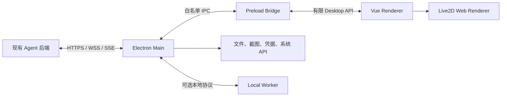
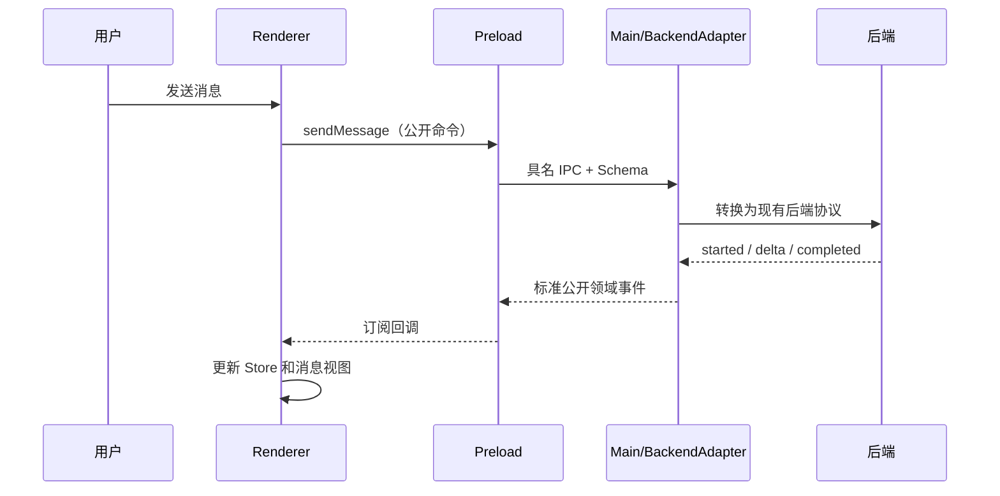
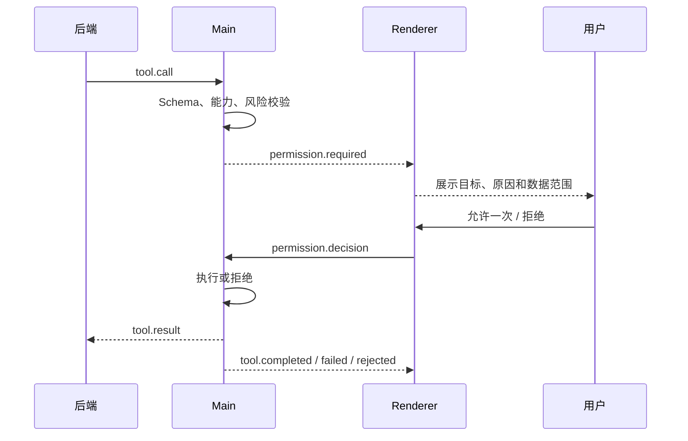

# Cyrene Electron 前端总体架构设计

**文档版本：** v0.2  
**文档状态：** 首轮 Review 已修订 / 待工程验证  
**适用范围：** Windows、Ubuntu Desktop Demo  
**技术基线：** Electron + Vue 3 + TypeScript + Vite  
**文档日期：** 2026-08-03
**最后复核日期：** 2026-08-04

> 本文只设计桌面客户端。现有后端视为外部系统，客户端通过适配层接入，不要求后端按照本文重构。

---

## 1. 设计目标

前端架构需要同时支撑五条核心链路：

1. 类 QQ 的会话与聊天体验；
2. AI 消息流式显示；
3. Live2D 角色渲染及状态联动；
4. Desktop Runtime 工具执行及用户授权；
5. 与现有后端稳定通信，并允许后端协议继续演进。

Demo 阶段优先保证边界清晰和主链路可验证，不追求插件市场、多窗口体系或任意代码执行。

## 2. 架构原则

### 2.1 前端适配现有后端

- 业务组件不直接依赖具体 URL、WebSocket 消息名称或后端字段；
- 后端差异集中在 `BackendAdapter`；
- UI 只使用前端领域模型；
- 后端字段变更不得扩散到全部 Vue 组件；
- 协议不匹配时应显式报错，不静默丢字段。

### 2.2 Renderer 不可信

- Renderer 不直接访问文件系统、系统凭据、Shell 或原始 Electron IPC；
- 所有本地系统能力由 Main 执行；
- Preload 只暴露有限、具名、经过校验的 API；
- 外部数据进入 Main、Preload 和 Renderer 时均进行 Schema 校验。

### 2.3 功能可降级

- Live2D 失败不影响聊天；
- 本地工具不可用不影响普通问答；
- 本地缓存损坏时可从后端重新获取会话；
- 网络断开时保留已显示内容和待发送草稿；
- Linux 截图不可用时只禁用该能力。

### 2.4 单向数据流

推荐数据流：

```text
后端事件 / Main 事件
        ↓
Main Transport + BackendAdapter + Schema 校验
        ↓
Preload 公开事件 / Renderer 领域服务
        ↓
Pinia Store
        ↓
Vue 组件
        ↓
用户操作 Command
        ↓
领域服务 / Desktop API
```

组件不得绕过 Store 和领域服务直接改变网络状态或工具生命周期。

## 3. 进程与信任边界



### 3.1 Main 进程职责

- 应用和窗口生命周期；
- 安全配置与导航拦截；
- 后端连接、认证凭据、原始协议解析和 `BackendAdapter`；
- 系统文件选择器；
- 受控文件读写；
- 屏幕及窗口选择；
- 本地权限决策与审计；
- 凭据安全存储；
- 日志、崩溃信息和应用版本；
- 可选 Local Worker 生命周期管理。

Main 不负责 Vue UI 状态和 Live2D 画面渲染。

### 3.2 Preload 职责

- 通过 `contextBridge` 暴露稳定接口；
- 将 Renderer 请求转换为具名 IPC；
- 对入参进行轻量校验；
- 对 Main 返回结果进行类型收敛；
- 提供事件订阅的取消函数；
- 不暴露原始 `ipcRenderer`、Node.js 模块或任意通道名称。

### 3.3 Renderer 职责

- 应用壳、导航、会话、聊天和设置 UI；
- Markdown 安全渲染；
- 流式消息合并和视图刷新；
- 工具卡片与授权对话框展示；
- Live2D 渲染和表现状态；
- 前端状态管理；
- 不直接连接带凭据的后端，不直接访问文件系统、系统凭据或其他操作系统能力。

### 3.4 Local Worker

Local Worker 是可选能力，不作为首个可运行版本的阻塞项。

若启用，应满足：

- 只监听本机安全通道；
- 使用一次性会话凭据；
- 由 Main 发现和管理；
- Renderer 不直接连接；
- Worker 暴露的工具仍进入统一权限和审计流程。

## 4. 前端模块

| 模块 | 主要职责 | 禁止承担 |
|---|---|---|
| App Shell | 窗口框架、导航、全局状态 | 聊天协议解析 |
| Conversations | 会话列表、选择、搜索、重命名、删除、游标分页 | 直接访问数据库 |
| Chat | 回复组、句子分段、输入、流式展示、Token/模型/心情、停止生成 | 直接执行桌面工具 |
| History Viewer | 消息搜索、日期/分类过滤、结果定位、资源与表情集中查看 | 自行解释后端查询语法 |
| Conversation Resources | 图片、视频、音频、表情、文件与链接索引及来源跳转 | 保存二进制副本 |
| Transport | 连接、重连、事件分发、请求关联 | 操作 Vue DOM |
| Backend Adapter | 后端协议到领域模型的转换 | 保存 UI 状态 |
| Tools | 工具生命周期、卡片和状态 | 绕过权限执行 |
| Permissions | 用户授权、策略和审计 | 根据后端标记自动放行高风险操作 |
| Desktop Runtime | 文件、截图等受控执行 | 任意 Shell |
| Attachments | 点击/拖拽/粘贴选择、统一校验、预览、上传和引用 | drop 后自动上传或发送 |
| Model Services | 内置/自定义 LLM/STT/TTS Profile、测试、CRUD 和切换；输入法转写选择专用 STT Profile | 在 Renderer 保存密钥 |
| Voice Input | 普通录音输入、实时语音会话、字幕状态，以及按住说话转文字 | 把直接语音字幕写入文字草稿；未提示用户持续录音 |
| Stickers | Emoji 插入、表情包清单、发送引用与最近使用 | 执行表情资源中的脚本 |
| Live2D | 模型加载、状态、动作和口型 | 决定业务结果 |
| Settings | 设置读取、校验和持久化 | 保存明文 Token |
| Security Policy | 沙盒、黑名单、历史授权和撤销 | 用历史授权覆盖黑名单 |
| Diagnostics | 日志、连接状态、故障信息 | 记录完整敏感内容 |

## 5. 推荐目录结构

```text
apps/desktop/
├── src/
│   ├── main/
│   │   ├── app/
│   │   ├── windows/
│   │   ├── ipc/
│   │   ├── transport/
│   │   ├── tools/
│   │   ├── permissions/
│   │   ├── credentials/
│   │   ├── persistence/
│   │   └── diagnostics/
│   ├── preload/
│   │   ├── index.ts
│   │   └── desktop-api.ts
│   ├── renderer/
│   │   ├── app/
│   │   ├── pages/
│   │   ├── components/
│   │   ├── features/
│   │   │   ├── conversations/
│   │   │   ├── chat/
│   │   │   ├── history-viewer/
│   │   │   ├── stickers/
│   │   │   ├── dictation/
│   │   │   ├── tools/
│   │   │   ├── permissions/
│   │   │   ├── live2d/
│   │   │   └── settings/
│   │   ├── stores/
│   │   └── services/
│   └── shared/
│       ├── contracts/
│       ├── schemas/
│       ├── domain/
│       └── errors/
├── assets/live2d/
├── tests/
│   ├── unit/
│   ├── integration/
│   └── e2e/
└── forge.config.ts
```

`shared/contracts` 仅存放跨进程契约；不要把依赖 Electron 或 Vue 的实现放入该目录。

## 6. 核心接口边界

### 6.1 后端适配器

```typescript
interface BackendAdapter {
  connect(input: ConnectInput): Promise<BackendSession>;
  disconnect(): Promise<void>;
  listConversations(input: PageQuery): Promise<Page<Conversation>>;
  getConversation(input: GetConversationQuery): Promise<ConversationDetail>;
  getMessageContext(input: MessageContextQuery): Promise<MessagePage>;
  createConversation(input: CreateConversationInput): Promise<Conversation>;
  deleteConversation(id: string): Promise<void>;
  sendMessage(input: SendMessageInput): Promise<ClientRequestRef>;
  cancelGeneration(input: CancelGenerationInput): Promise<void>;
  listModelProfiles(type?: ModelServiceType): Promise<ModelProfile[]>;
  testModelProfile(input: TestModelProfileCommand): Promise<ModelProfileTestResult>;
  activateModelProfile(input: ActivateModelProfileCommand): Promise<void>;
  queryChatHistory(input: ChatHistoryQuery): Promise<ChatHistoryPage>;
  // —— 阶段 4 批次 B：语音（spec §5.4 方法集，Task 3 重写签名、Task 4/7 实现） ——
  startRecordVoice(input: VoiceRecordStartInput): Promise<{ recordingId: string }>;
  stopRecordVoice(input: VoiceRecordStopInput): Promise<void>;
  commitVoice(input: VoiceCommitInput): Promise<ClientRequestRef>;   // 发 voice.commit，await user_message.ack（幂等，按 clientRequestId）
  discardVoice(input: VoiceDiscardInput): Promise<void>;
  startRealtimeVoice(input: RealtimeVoiceStartInput): Promise<{ sessionId: string }>;
  stopRealtimeVoice(input: RealtimeVoiceControlInput): Promise<void>;
  cancelRealtimeVoice(input: RealtimeVoiceControlInput): Promise<void>;
  startDictation(input: DictationStartInput): Promise<{ clientRequestId: string }>;
  stopDictation(input: DictationStopInput): Promise<void>;
  cancelDictation(input: DictationStopInput): Promise<void>;
  sendAudioBytes(bytes: Uint8Array): void;   // 同步 fire-and-forget（唯一同步方法）：连接 + 活动语音会话双 guard，否则丢弃 + warn
  audioCancel(input: AudioCancelInput): Promise<void>;
  submitToolResult(input: ToolResult): Promise<void>;
  subscribe(handler: BackendEventHandler): () => void;
}
```

现有后端如果使用不同 API，只修改适配器实现和字段映射。

### 6.2 Desktop API

```typescript
interface DesktopApi {
  getAppInfo(): Promise<AppInfo>;
  selectFiles(input: SelectFilesInput): Promise<SelectedFile[]>;
  requestToolExecution(input: DesktopToolRequest): Promise<ToolExecutionReceipt>;
  respondPermission(input: PermissionDecision): Promise<void>;
  cancelTool(input: CancelToolInput): Promise<void>;
  // —— 阶段 4 批次 B：语音与本地设置（preload desktopApi，ipc.ts 通道） ——
  voiceStartRecord(input: VoiceRecordStartInput): Promise<{ recordingId: string }>;
  voiceStopRecord(input: VoiceRecordStopInput): Promise<void>;
  voiceCommit(input: VoiceCommitInput): Promise<ClientRequestRef>;
  voiceDiscard(input: VoiceDiscardInput): Promise<void>;
  voiceStartRealtime(input: RealtimeVoiceStartInput): Promise<{ sessionId: string }>;
  voiceStopRealtime(input: RealtimeVoiceControlInput): Promise<void>;
  voiceCancelRealtime(input: RealtimeVoiceControlInput): Promise<void>;
  voiceStartDictation(input: DictationStartInput): Promise<{ clientRequestId: string }>;
  voiceStopDictation(input: DictationStopInput): Promise<void>;
  voiceCancelDictation(input: DictationStopInput): Promise<void>;
  voiceSendAudio(bytes: Uint8Array): void;   // 单向 send（voice:audio-chunk，一次性 Uint8Array 拷贝防 DataCloneError）
  audioCancel(input: AudioCancelInput): Promise<void>;
  settingsLoad(): Promise<SettingsState>;
  settingsSave(patch: SettingsPatch): Promise<SettingsState>;
  listSecurityPolicy(): Promise<PublicSecurityPolicy>;
  updateSecurityPolicy(input: SecurityPolicyUpdate): Promise<PublicSecurityPolicy>;
  listPermissionHistory(input: PageQuery): Promise<Page<PermissionHistoryItem>>;
  revokePermissionGrant(input: RevokePermissionGrantInput): Promise<void>;
  readSettings(): Promise<PublicSettings>;
  updateSettings(input: UpdateSettingsInput): Promise<PublicSettings>;
  openExternal(input: OpenExternalInput): Promise<void>;
  onDesktopEvent(handler: DesktopEventHandler): () => void;
}
```

Renderer 不获得用于绕过工具层的 `readFile(path)` 或 `exec(command)` 接口。

模型服务只定义 LLM、STT、TTS 三类 Profile。Profile 的实际配置来源可以是现有后端、Local Worker 或受控本机模型适配层；前端通过 Adapter 呈现统一的查看、测试和切换体验。输入法转写不创建第四类模型服务，而是在独立设置中选择一个兼容 STT Profile。模型密钥只显示配置状态，不向 Renderer 返回明文。

### 6.3 拖拽文件的进程边界

Renderer 的 Drop/Paste 事件只负责收集浏览器 `File` 对象和显示待发送 UI。需要取得真实磁盘文件时，由 Preload 使用 Electron `webUtils.getPathForFile(file)`，随后立即交给 Main 转换为客户端内部不透明资源句柄；Renderer 业务 Store 不保存或向后端发送绝对路径。不得依赖旧的 `File.path` 扩展属性，也不得向页面暴露通用“路径转文件”或“按路径读取”接口。

点击选择、拖拽和粘贴最终都进入 Main 的同一校验链：数量/大小/类型 → 路径与符号链接 → 敏感范围 → 生成句柄 → 待发送附件。浏览器内构造、没有磁盘来源的 `File` 只能按内存附件处理，不能假定存在本地路径。

## 7. 关键流程

### 7.1 聊天生成



### 7.2 Desktop Runtime 工具调用



### 7.3 Backend Runtime 工具调用

后端工具由后端自行执行。前端只在收到公开状态事件时展示进度，不参与权限执行，也不假设能够访问后端内部参数。若后端未发送工具过程事件，前端只展示最终 AI 消息。

### 7.4 双通道 Assistant 消息

BackendAdapter 将一次后端 AI 回复映射为一个父 Message/Response，并把句子流映射为有序 `AssistantSegment[]`。`responseId` 决定父级归并，`segmentIndex` 决定 Inner Voice/Public Reply 及多媒体分段的全局展示顺序，`deltaSequence` 只在分段内部累计。分段完成不结束父消息，UI 不因一句话完成而创建新的头像、时间或消息操作区。

回复完成事件统一写入该消息的 Token、实际模型和心情，同时更新会话级 Token 聚合。Search 与 Conversation Resources 只引用标准 `messageId/responseId/segmentId`，不保存第二份消息正文。

### 7.5 语音输入

语音模块包含两种严格分离的产品链路：

1. **直接语音输入：** 普通模式录制音频输入，实时模式建立持续语音会话；STT 的 partial/final 只作为字幕或识别状态，不能写入可编辑文字草稿。普通模式的音频进入待发送语音输入，实时模式按已确认的断句规则提交语音轮次。
2. **输入法转写：** 按住说话，松开后只把最终文字插入当前会话草稿；不创建语音消息，也不自动发送。

两条链路都由 Main 管理麦克风会话和数据路由。输入法转写根据 `dictationSttProfileId` 选择兼容 STT Profile，执行位置由该 Profile 声明为 Backend、Local Worker 或受控本机适配层；后端执行前必须公开音频上传事实。取消或失败不改变既有草稿，临时音频按策略清理。

> **阶段 4 批次 B（2026-08-16）落地同步：** 三种语音（普通录音 / 实时语音会话 / 输入法转写）+ TTS 自动朗读已实现（Mock 驱动，标「已开发、未联调」）。实现面：Renderer `PcmCapture` 承担麦克风采集（AudioWorklet/ScriptProcessor 降级），Main 负责麦克风权限决策（`decideMicrophoneAllow`/`registerMicrophonePermission`，仅 audio + 受信 origin）、`voice:audio-chunk` 单向 IPC 守卫（`registerOneWayHandler`，1 MiB 上限）、TTS base64 帧解码 → MediaService `tts-live` 路由、语音族错误 `voice.error` 路由（D-P15）；Renderer `voiceStore` 三模式编排 + `settingsStore` 本地设置持久化。BINARY 上行与 TTS 播放映射见 doc 02 §13；接口方法见 §6.1。

### 7.6 聊天历史与表情

统一历史查看器使用关键词、日期、分类和游标查询消息，图片/视频、表情包、文件、音频和链接（后端六分类）只保存来源引用。搜索结果与资源项通过 `messageId/responseId/segmentId` 加载上下文并跳转。Emoji 修改草稿文本，表情包作为结构化附件进入发送队列，两者均不自动发送。

## 8. 应用生命周期

### 8.1 启动

1. Main 初始化日志和配置；
2. 读取安全凭据；
3. 创建窗口并加载本地 Renderer（打包/构建产物经 `cyrene://` 受限自定义协议，替代 `file://`；dev 走 Vite http）——阶段 1 块 A 已落地；
4. Renderer 加载非敏感设置；
5. 初始化 Store 和 Live2D；
6. BackendAdapter 建立连接；
7. 交换协议版本和客户端能力；
8. 拉取会话列表并恢复最近会话。

### 8.2 退出

- 停止新工具调用；
- 取消尚未授权的 Desktop 工具；
- 对执行中的写操作等待安全结束或回滚；
- 保存草稿和非敏感界面状态；
- 关闭连接和 Local Worker；
- 刷新脱敏日志。

## 9. 跨平台策略

| 能力 | Windows | Ubuntu X11 | Ubuntu Wayland |
|---|---|---|---|
| 文本文件选择 | 系统对话框 | 系统对话框 | 系统对话框 |
| 文本读写 | Node 受控执行 | Node 受控执行 | Node 受控执行 |
| 屏幕选择 | Electron/系统能力 | Electron/桌面能力 | 优先系统 Portal |
| 凭据 | 系统凭据能力 | Secret Service | Secret Service |
| 外部链接 | 系统浏览器 | 系统浏览器 | 系统浏览器 |

平台差异封装在 Main 的适配器中，上层工具名称和结果结构保持一致。

## 10. 性能边界

- 流式 Token 不逐个触发完整 Markdown 重算，按时间片批量刷新；
- Main/Preload 不为每个 Token 单独跨 IPC；Adapter 在保留序号边界的前提下按短时间片或大小阈值合并公开增量；
- 长会话使用虚拟列表或分段渲染；
- Live2D 渲染与消息状态解耦，可降低到 30 FPS；
- 隐藏 Live2D 时暂停高频渲染；
- 大文件读取、哈希和上传不在 Renderer 主线程执行；
- 单个工具或 Live2D 异常不得造成整个窗口崩溃。

## 11. 必须与后端核对的接口点

- 后端当前使用 WebSocket、SSE 还是二者并存；
- 用户消息由 REST 还是长连接发送；
- 流式消息的事件名称和增量格式；
- 会话和消息的唯一 ID 规则；
- 工具调用、结果及取消的现有字段；
- 同一消息中 Inner Voice 与 Public Reply 的字段和流式规则；
- LLM、STT、TTS Profile 的查看、测试和切换接口，以及输入法转写选择专用 STT Profile 的配置接口；
- 普通录音输入、实时语音会话、可选字幕及语音轮次提交事件；
- Backend Runtime 是否向客户端公开执行过程；
- 附件上传方式和最大限制；
- 断线续传游标或事件序号；
- Token 获取、刷新和失效方式；
- 后端协议版本协商方式。

这些差异通过 `BackendAdapter` 消化，不应成为 UI 组件的条件分支。

## 12. 架构验收标准

- [ ] Main、Preload、Renderer 边界落地；
- [ ] Renderer 无 Node.js 直接访问能力；
- [ ] 后端字段只在 Adapter 层出现；
- [ ] IPC 和网络输入均有运行时 Schema；
- [ ] 聊天、Live2D、工具模块可以独立失败和恢复；
- [ ] Windows 与 Ubuntu 共用领域层和 Renderer 主代码；
- [ ] Desktop Runtime 工具无法绕过权限层；
- [ ] 后端协议变化可通过替换 Adapter 适配。
- [ ] Inner Voice 与 Public Reply 作为同一消息的两个内容区处理；
- [ ] 同一 `responseId` 的句子分段只形成一个回复组，分段完成与父回复完成分离；
- [ ] Token、模型、心情、搜索和资源索引有明确模块边界且不复制消息事实；
- [ ] 统一历史查看器、表情系统、模型服务、语音输入和安全策略均有独立模块边界；
- [ ] Live2D 打开时作为聊天区右侧布局列扩展，不通过覆盖层遮挡聊天；
- [ ] 直接语音输入的字幕不写入文字草稿；输入法转写只写入草稿，不创建语音消息或自动发送；
- [ ] 自定义模型 Profile 生命周期和拖拽附件队列不绕过 Main、凭据及附件安全边界；
