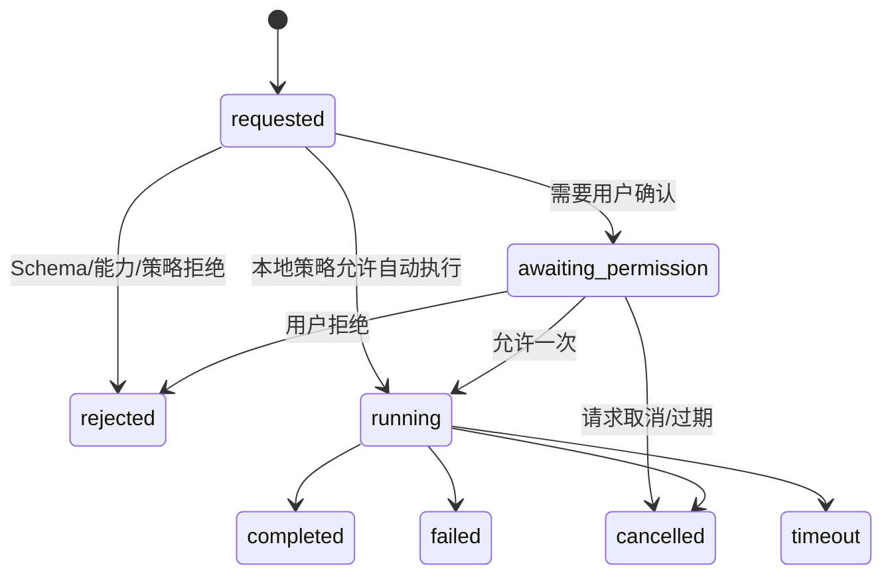

# Cyrene Desktop 工具与权限交互设计

**文档版本：** v0.2  
**文档状态：** 首轮 Review 已修订 / 待与 Tool Registry 对齐  
**适用范围：** Electron Main、Preload、Renderer 及 Desktop Runtime  
**文档日期：** 2026-08-03
**最后复核日期：** 2026-08-04

> 后端和 Desktop Runtime 可以同时执行工具，但后端不能直接访问客户端资源。本文只规定前端如何接收、审核、展示和执行 Desktop/Local Worker 工具，以及如何展示 Backend Runtime 状态。

---

## 1. 目标与边界

### 1.1 目标

- 所有本地操作通过结构化工具注册；
- 工具执行区域明确可见；
- 高风险操作由本地策略决定是否授权；
- 用户能理解操作目标、原因和数据流向；
- 重连和重复事件不会重复产生副作用；
- 工具执行留下脱敏审计记录。

### 1.2 明确禁止

- 后端下发 JavaScript、Python、Shell、PowerShell 或 Bash 供客户端解释执行；
- Renderer 直接读写任意文件；
- 通过通用 IPC 传入任意通道和参数；
- 以“后端标记为安全”为由绕过本地权限策略；
- 未经确认读取敏感目录、截图或覆盖文件；
- 将完整文件内容、截图或 Token 写入普通日志。

## 2. 前端工具注册模型

```typescript
interface LocalToolDefinition<TInput, TOutput> {
  name: string;
  version: string;
  runtime: "desktop" | "local_worker";
  title: string;
  description: string;
  riskLevel: "safe" | "medium" | "high" | "prohibited";
  permissionMode: "automatic" | "scoped_or_prompt" | "always_prompt" | "prohibited";
  supportedPlatforms: Array<"windows" | "linux">;
  inputSchema: Schema<TInput>;
  outputSchema: Schema<TOutput>;
  summarizeInput(input: TInput): ToolInputSummary;
  executeRef: string;
}
```

`executeRef` 只引用 Main 内部已编译、已注册的执行器或受信 Worker 路由，不是后端可提供的代码、模块路径或命令。Desktop 与 Local Worker 可以共用注册元数据，但只有 Desktop 执行器直接在 Main 的受控能力层运行。

Demo 使用静态注册表。运行时插件加载不在 P0 范围。

注册表需要保证：

- 名称唯一；
- 版本明确；
- Schema 在执行前生效；
- 风险等级由本地定义；
- 不支持的平台不注册；
- 用户界面名称不直接使用内部工具名。

## 3. Runtime 路由

```text
tool.call
   ↓
读取 runtime
   ├── backend      → 只更新前端展示
   ├── desktop      → Main 注册表 + 权限 + 执行
   └── local_worker → Main 路由 Worker + 权限 + 执行
```

未知 Runtime 默认拒绝并返回 `CAPABILITY_UNAVAILABLE`。

后端不得把 `backend` 工具改标为 `desktop` 来获得本地权限；Main 只执行注册表中名称、Runtime 和版本均匹配的工具。

## 4. 工具生命周期



状态只能单向前进。终态 `completed`、`failed`、`rejected`、`cancelled`、`timeout` 不得重新进入执行状态。

## 5. 请求处理顺序

Main 收到 Desktop 工具调用后：

1. 校验事件外壳、大小和版本；
2. 按 `callId` 查询幂等记录；
3. 查找本地注册工具；
4. 校验 Runtime、工具版本和平台支持；
5. 使用工具专属 Schema 校验参数；
6. 规范化路径等敏感参数；
7. 计算本地风险和权限策略；
8. 生成安全、可展示的输入摘要；
9. 请求用户授权或进入运行；
10. 执行并支持取消、超时；
11. 校验输出 Schema；
12. 过滤或上传大结果；
13. 回传结果并写入脱敏审计。

任一步失败都返回结构化错误，不继续执行后续步骤。

## 6. IPC 设计

### 6.1 公开接口

Preload 可以公开：

```typescript
interface ToolDesktopBridge {
  respondPermission(input: PermissionDecision): Promise<void>;
  cancelTool(input: { callId: string }): Promise<void>;
  onToolEvent(handler: (event: PublicToolEvent) => void): () => void;
}
```

### 6.2 禁止接口

```typescript
// 禁止：Renderer 可传任意路径直接读取
readFile(path: string): Promise<string>;

// 禁止：Renderer 可指定任意 IPC 名称
invoke(channel: string, args: unknown): Promise<unknown>;

// 禁止：任意命令执行
exec(command: string): Promise<string>;
```

### 6.3 公开事件

Renderer 只接收脱敏后的事件：

```typescript
interface PublicToolEvent {
  callId: string;
  toolName: string;
  title: string;
  runtime: "backend" | "desktop" | "local_worker";
  status: ToolCallStatus;
  reason?: string;
  inputSummary?: ToolInputSummary;
  resultSummary?: string;
  error?: PublicError;
  occurredAt: string;
}
```

## 7. 权限模型

### 7.1 风险等级

| 等级 | 示例 | Demo 策略 |
|---|---|---|
| safe | 获取应用版本、读取用户刚主动选择的非敏感元数据 | 可自动执行或弱提示 |
| medium | 读取文本文件、上传文件、截图 | 每次确认 |
| high | 覆盖文件、访问敏感路径、批量操作 | 强确认或拒绝 |
| prohibited | 任意命令字符串、密钥读取、静默截图、大量删除 | 默认禁止 |

后端风险等级只用于解释；最终等级由本地注册表和参数共同计算。

### 7.2 决策结构

```typescript
interface PermissionDecision {
  callId: string;
  decision: "allow_once" | "allow_scoped" | "deny";
  grantScope?: {
    directoryIds?: string[];
    commandTemplateIds?: string[];
    expiresAt?: string;
  };
  decidedAt: string;
}
```

长期或范围授权必须绑定工具、规范化资源范围、后端身份、参数限制和有效期，并可在设置页查看及撤销。高风险操作仍可强制逐次确认。

### 7.3 权限窗口内容

- 操作名称；
- 执行区域；
- 当前会话；
- 请求原因；
- 目标资源；
- 将读取、修改或上传的数据；
- 风险说明；
- 允许一次、拒绝；
- 工具支持范围授权时，显示“允许指定范围”，并明确目录、模板、参数和有效期；
- 写入操作的差异预览。

关闭窗口、请求过期和应用退出均按拒绝或取消处理。

### 7.4 沙盒、黑名单和授权记录

```typescript
interface SandboxDirectory {
  id: string;
  normalizedPath: string;
  displayPath: string;
  permissions: Array<"read" | "write" | "execute_template">;
  createdAt: string;
}

interface PermissionGrant {
  id: string;
  subject: "directory" | "command_template" | "domain";
  subjectId: string;
  toolNames: string[];
  backendIdentity: string;
  argumentConstraints?: Record<string, unknown>;
  createdAt: string;
  expiresAt?: string;
  revokedAt?: string;
}

interface SecurityPolicy {
  sandboxDirectories: SandboxDirectory[];
  pathBlacklist: string[];
  domainBlacklist: string[];
  grants: PermissionGrant[];
}
```

决策优先级：

```text
禁止工具/非法参数
    ↓
路径或域名黑名单
    ↓
本地风险强制逐次确认
    ↓
有效范围授权
    ↓
沙盒目录默认策略
    ↓
请求用户审批
```

黑名单始终覆盖沙盒和历史授权。路径先规范化并解析符号链接；域名转为规范形式后再匹配精确项和受控通配符。

## 8. Desktop P0 工具定义

### 8.1 `desktop.file.select`

由用户主动打开系统文件选择器。

要求：

- 过滤器由客户端白名单生成；
- 返回选择结果和客户端内部句柄；
- 不因为选择文件就自动上传内容；
- 取消选择不是程序错误；
- 后续访问优先使用受控句柄，而非信任后端提供的绝对路径。

### 8.2 `desktop.file.read`

要求：

- 只读取用户选择或明确授权的文本文件；
- 默认最大 2 MB，可配置但有硬上限；
- 路径规范化并检查符号链接；
- Windows 拒绝未授权 UNC/设备路径、ADS 和重解析点逃逸；Linux 校验解析后的真实路径；
- 敏感路径拒绝或强警告；
- 读取期间检测文件变化；
- 返回字符集、大小、哈希和内容；
- 大内容使用附件上传，不进入普通日志。

### 8.3 `desktop.file.write`

要求：

- 展示目标、新建/覆盖类型和差异；
- 检测并在 Diff 中标明编码、BOM 与换行风格；无法无损解码时拒绝按文本覆盖；
- 覆盖前检查原文件哈希；
- 使用临时文件和原子替换；
- 冲突时停止并返回 `FILE_CONFLICT`；
- 禁止目录遍历、符号链接逃逸和批量覆盖；
- Demo 不支持删除文件；
- 失败时尽量保持原文件不变。
- 默认保留原文件编码、BOM、换行和末尾换行；发生转换必须在确认窗口明确显示。

### 8.4 `desktop.screen.capture`

要求：

- 每次由用户选择屏幕或窗口；
- Wayland 优先使用系统授权流程；
- 预览截图并明确提示是否上传；
- 不支持静默捕获、定时捕获或录屏；
- 返回图片附件 ID、尺寸和格式；
- 临时图片在完成或取消后按策略清理。

## 9. 可选受控命令：`desktop.command.run`

该工具不属于默认 P0，仅在项目明确启用受控命令执行时注册。设置页即使未启用执行，也需要提供已授权命令模板的列表、空状态和撤销入口。启用后只执行本地预先登记的命令模板，不接受后端传入任意命令字符串。

```typescript
interface CommandTemplate {
  id: string;
  title: string;
  executable: string;
  executableSha256?: string;
  fixedArguments: string[];
  allowedArgumentSchema?: Schema<unknown>;
  allowedWorkingDirectoryIds: string[];
  readOnly: boolean;
  timeoutMs: number;
}
```

要求：

- 设置页列出已授权命令模板和目录；
- 授权显示来源、参数范围、有效期和撤销操作；
- 工作目录必须位于允许的沙盒目录；
- 路径与域名黑名单仍然生效；
- 禁止 Shell 拼接、重定向、管道和命令替换；
- 可执行文件使用本地注册时解析的绝对路径，不通过 `PATH` 搜索；执行前复核文件身份、哈希或平台签名，变化后使授权失效；
- 参数必须通过模板 Schema；
- 未登记模板默认拒绝；
- 输出限制大小并脱敏；
- 非只读模板原则上逐次确认。

## 10. 本地 Worker 工具

Local Worker 请求仍走相同生命周期。Main 负责：

- 验证 Worker 身份和版本；
- 限定工具清单；
- 传递最少必要输入；
- 监控超时和退出；
- 校验结果；
- 将进度转为统一工具状态。

Worker 断开时返回失败，不能自动切换到后端执行并上传用户数据，除非用户提前明确同意这种回退。

## 11. Backend Runtime 的前端展示

对于后端执行的工具：

- 前端可以显示“在服务器执行”；
- 只展示后端主动公开的状态摘要；
- 不进入 Desktop 本地权限决策；若后端要求用户审批，则使用明确标注“服务器操作”的审批样式并把决定回传后端；
- 服务端审批不能创建或复用本地目录、命令模板或域名授权；
- 如果后端工具会使用用户上传的数据，上传行为本身仍应在前端明确；
- 后端工具失败不应被误报为客户端故障；
- 客户端审计只记录收到的公开事件，不伪造后端内部细节。

> **阶段 6 决策注记（2026-08-19，方案 B，待实现）：** Backend Runtime 的展示数据源定为新帧 `tool.started/tool.completed`（v2），不再消费泛型 `action`；前端统一领域键 = `sourceCallId`（LLM `tool_call_id`），Desktop 桥 `call_*` 只用于 `tool.request/tool.status` 执行协议。Desktop 终态由前端本地状态机裁决，后端 `tool.completed` 按 `sourceCallId` 与服务端归档确认合并。完整更新点见 `docs/review/2026-08-19-阶段6-工具双轨统筹决策记录.md`。

## 12. 取消、超时和并发

- 每个工具定义默认超时；
- 用户可取消可中断的长任务；
- 写入临界区内的取消需要安全完成或回滚；
- 同一路径写操作串行；
- 截图选择器同一时间只允许一个；
- 不同只读工具可有限并发；
- 应用退出前停止接收新调用；
- 后端取消与用户取消使用不同审计来源。

## 13. 幂等

Main 按 `callId` 保存短期执行记录：

- 第一次请求：正常处理；
- 已等待授权：返回当前状态，不重复弹窗；
- 正在执行：返回运行中；
- 已完成：返回之前的结果摘要或引用；
- 已拒绝：保持拒绝；
- 参数与相同 `callId` 不一致：拒绝并记录协议错误。

副作用工具的幂等记录应跨短时重连保留。

## 14. 审计记录

```typescript
interface ToolAuditRecord {
  callId: string;
  toolName: string;
  runtime: "backend" | "desktop" | "local_worker";
  backendIdentity?: string;
  conversationId?: string;
  inputSummary: string;
  riskLevel: "safe" | "medium" | "high";
  permissionDecision?: "allow_once" | "allow_scoped" | "deny";
  permissionGrantId?: string;
  status: ToolCallStatus;
  startedAt?: string;
  finishedAt: string;
  errorCode?: string;
}
```

审批历史应允许用户按工具、目录、命令模板、结果和时间查看，并可从相关记录跳转撤销长期授权。不得保存完整文件内容、截图内容、认证 Token、密钥或未脱敏的敏感参数。

Backend Runtime 记录只保存客户端实际收到的公开事件；Desktop/Local Worker 记录由 Main 生成。两者必须在 UI 中标明数据完整性范围，不能把客户端摘要称为后端完整审计。

## 15. 失败处理

| 失败 | 行为 |
|---|---|
| 未注册工具 | 拒绝并报告能力不可用 |
| 参数不合法 | 不弹权限窗，直接失败 |
| 用户拒绝 | 回传拒绝，聊天继续 |
| 请求过期 | 标记超时，不执行 |
| 文件冲突 | 保留原文件，提示重新确认 |
| Worker 退出 | 工具失败，不擅自上传回退 |
| WebSocket 断开 | 安全结束本地操作，结果待重连回传 |
| 回传失败 | 保留幂等结果，重连后重发 |

## 16. 验收标准

- [ ] 所有 Desktop 工具来自静态注册表；
- [ ] 未注册工具无法进入执行器；
- [ ] Renderer 无通用文件或命令接口；
- [ ] 中高风险操作按照本地策略确认；
- [ ] 文件写入有差异和冲突保护；
- [ ] 截图每次由用户选择并确认上传；
- [ ] 沙盒目录、路径黑名单和域名黑名单按明确优先级生效；
- [ ] 权限审批历史可查看，范围授权可撤销；
- [ ] 已授权命令模板和目录可查看及撤销；若启用 `desktop.command.run`，只能引用本地受控模板，不能执行任意命令字符串；
- [ ] 相同 `callId` 不重复产生副作用；
- [ ] 断线后结果可以安全重发；
- [ ] Backend Runtime 与 Desktop Runtime 在 UI 中可区分；
- [ ] 审计日志不包含完整敏感内容。
