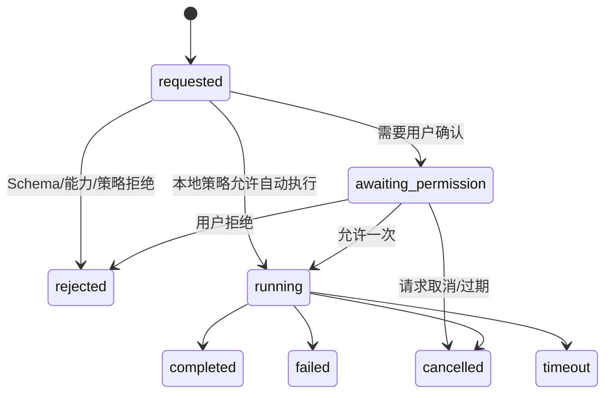

# Cyrene Desktop 工具与权限交互设计

**文档状态：** 维护中
**最后核验：** 2026-08-29
**适用阶段：** 阶段 6～8
**权威范围：** Desktop 工具、权限、授权历史和审计交互
**初始文档日期：** 2026-08-03

> **状态说明：** 正文中的带日期实施/联调注记只代表当时快照；当前阶段、阻塞项和最近验证统一读取 [doc 16](16-Cyrene-前端实施任务清单与进度跟踪.md)。

> 后端和 Desktop Runtime 可以同时执行工具，但后端不能直接访问客户端资源。本文只规定前端如何接收、审核、展示和执行 Desktop/Local Worker 工具，以及如何展示 Backend Runtime 状态。

---

## 1. 目标与边界

### 1.1 目标

- 所有本地操作通过结构化工具注册；
- 工具执行区域明确可见；
- 高风险操作由本地策略决定是否授权；
- 用户能理解操作目标、原因和数据流向；
- 重连和重复事件不会重复产生副作用；
- 工具执行留下脱敏审计记录。

### 1.2 明确禁止

- 后端下发 JavaScript、Python、Shell、PowerShell 或 Bash 供客户端解释执行；
- Renderer 直接读写任意文件；
- 通过通用 IPC 传入任意通道和参数；
- 以“后端标记为安全”为由绕过本地权限策略；
- 未经确认读取敏感目录、截图或覆盖文件；
- 将完整文件内容、截图或 Token 写入普通日志。

> **阶段 7 批次 B（2026-08-25，安全面——凭据 fail-closed 不拉平，Mock 驱动，标「已开发、未联调」）：** 本批缓存损坏统一层 `createCorruptIsolation` **只由 settings/session-store 采用，CredentialsStore（安全凭据）不纳入**（主会话裁决）。理由是凭据安全语义与统一层的「隔离 + 重建默认 + fail-open」相反（凭据损坏必须 fail-closed：拒绝使用该凭据，绝不「重建空凭据」）；不为密文增 `.corrupt-*` 磁盘备份副本（即使密文也扩大攻击面）；既有 CredentialStore 自身已 fail-closed（阶段 0/1 整改 FE-S1-P1-03 `EMPTY_FILE` 工厂化）。此裁决维持 doc 06 §8.2「Token/凭据不落普通配置、不显示明文」与 doc 07 §12 敏感面纪律不变——工具/凭据安全边界不因本批放宽。

## 2. 前端工具注册模型

> **阶段 6 批次 A 注记（2026-08-20）**：领域统一调用记录为 `ToolCallRecord`，**权威键 `id = sourceCallId`（LLM `tool_call_id`）**；`desktopCallId`（桥 `call_*`）只作执行协议关联（ID 双轨，D6-03）。wire 双轨：Desktop 执行握手 `tool.request/tool.status`、Backend 展示生命周期 `tool.started/tool.completed`；前端领域单轨统一。详见 `docs/review/2026-08-20-阶段6批次A-决策记录.md`。

> **阶段 6 批次 B 注记（2026-08-20）**：静态注册表已落地为 `apps/desktop/src/main/tools/tool-registry.ts` 的 `createToolRegistry()`——四个 Desktop P0 工具（`desktop.file.select/read/write` + `desktop.screen.capture`），每项 `name/version/runtime:'desktop'/title/description/dataFlowNote/localRisk/permissionMode/supportedPlatforms/inputSchema/outputSchema/executeRef/defaultTimeoutMs/isPathTool`；未知名称/版本/运行时/**平台不匹配**一律拒绝（`CAPABILITY_UNAVAILABLE`，不弹窗）。四工具元数据落地值：`desktop.file.select`（safe/automatic，`{title?}` 不接受 filters——客户端白名单生成，dataFlowNote「选择的文件路径、大小与哈希摘要将发送到已连接的后端服务器；文件内容不会自动上传」）、`desktop.file.read`（medium/scoped_or_prompt，本批按「每次确认 + selected-set 豁免」实现，`{path: string.min(1)}` strict，dataFlowNote「读取的文件内容（≤64 KiB 内联 / 更大经附件上传）将发送到已连接的后端服务器」）、`desktop.file.write`（high/always_prompt，`{path, content}` strict，dataFlowNote「写入内容将覆盖/创建目标文件，文件内容将发送到已连接的后端服务器」）、`desktop.screen.capture`（high/always_prompt，`{region: string.nullish()}` strict——契约对齐：后端 `ScreenCaptureParams` 产出 `{"region": null}`，nullish() 放行 null/缺省，dataFlowNote「所选屏幕/窗口截图将发送到已连接的后端服务器」）；`desktop.command.run` 确认不注册（全阶段不注册）。详见 `docs/review/2026-08-20-阶段6批次B-决策记录.md`。

```typescript
interface LocalToolDefinition<TInput, TOutput> {
  name: string;
  version: string;
  runtime: "desktop" | "local_worker";
  title: string;
  description: string;
  riskLevel: "safe" | "medium" | "high" | "prohibited";
  permissionMode: "automatic" | "scoped_or_prompt" | "always_prompt" | "prohibited";
  supportedPlatforms: Array<"windows" | "linux">;
  inputSchema: Schema<TInput>;
  outputSchema: Schema<TOutput>;
  summarizeInput(input: TInput): ToolInputSummary;
  executeRef: string;
}
```

`executeRef` 只引用 Main 内部已编译、已注册的执行器或受信 Worker 路由，不是后端可提供的代码、模块路径或命令。Desktop 与 Local Worker 可以共用注册元数据，但只有 Desktop 执行器直接在 Main 的受控能力层运行。

Demo 使用静态注册表。运行时插件加载不在 P0 范围。

注册表需要保证：

- 名称唯一；
- 版本明确；
- Schema 在执行前生效；
- 风险等级由本地定义；
- 不支持的平台不注册；
- 用户界面名称不直接使用内部工具名。

## 3. Runtime 路由

```text
tool.call
   ↓
读取 runtime
   ├── backend      → 只更新前端展示
   ├── desktop      → Main 注册表 + 权限 + 执行
   └── local_worker → Main 路由 Worker + 权限 + 执行
```

未知 Runtime 默认拒绝并返回 `CAPABILITY_UNAVAILABLE`。

> **D4-2 落地口径（2026-09-15 裁决「改文档」）：当前 wire 侧 `runtime` 是硬编码占位，不做取值校验。**
> 实测：`real-backend.ts` 组 `DesktopToolRequest` 时固定写 `runtime: 'desktop'`（**不读 `frame.runtime`**），
> 全仓无「非 desktop → 拒绝」的判定；raw 层也把该字段当普通 `str`。之所以当前不构成放行漏洞：
> `tool-service` 只认**本地静态注册表**（`createToolRegistry()` 的四个 desktop 工具），未注册名一律
> `CAPABILITY_UNAVAILABLE`，执行器又由 `executeRef` 本地解析——「后端把 backend 工具改标 desktop」
> 拿不到任何本地能力。⇒ **上文「未知 Runtime 默认拒绝」是目标口径，当前由注册表白名单间接达成，
> 不是由 runtime 取值校验达成**；等出现第二种 runtime（`local_worker`）时必须补真正的取值校验，届时本节按实改。

后端不得把 `backend` 工具改标为 `desktop` 来获得本地权限；Main 只执行注册表中名称、Runtime 和版本均匹配的工具。

## 4. 工具生命周期



状态只能单向前进。终态 `completed`、`failed`、`rejected`、`cancelled`、`timeout` 不得重新进入执行状态。

> **阶段 6 批次 A 注记（2026-08-20）**：上图 8 态为**前端展示态**（`ToolCallStatus`）；客户端→服务端回传 `tool.status` 是 **wire 六态协议态**（`ToolWireStatus`：accepted/rejected/running/result/error/cancelled），映射：accepted/running→展示 running；result→completed；error→failed；rejected/cancelled 同名；requested/awaiting_permission/timeout 为本地态，**wire 枚举里没有同名 `timeout` 值**（`shared/contracts/backend.ts:147` 六态）——但执行超时经 `error{code:'TIMEOUT'}`、expiresAt 过期经 `cancelled` 表达，重连时服务端 `expired` 回翻为本地 `timeout`（`tool-service.ts:202-208/265/415`）。两套语义分离（D6A-05），`tool.status` 只能由 Main 组装（D6-07）。

## 5. 请求处理顺序

Main 收到 Desktop 工具调用后：

1. 校验事件外壳、大小和版本；
2. 按 `callId` 查询幂等记录；
3. 查找本地注册工具；
4. 校验 Runtime、工具版本和平台支持；
5. 使用工具专属 Schema 校验参数；
6. 规范化路径等敏感参数；
7. 计算本地风险和权限策略；
8. 生成安全、可展示的输入摘要；
9. 请求用户授权或进入运行；
10. 执行并支持取消、超时；
11. 校验输出 Schema；
12. 过滤或上传大结果；
13. 回传结果并写入脱敏审计。

任一步失败都返回结构化错误，不继续执行后续步骤。**落地次序注记（2026-08-20 批次 B，取代上文次序）**：`tool-service.ts:497-573` 的实际顺序为「注册表+平台 → 参数 schema → callId 幂等 → paramHash 校验 → realpath+黑名单 → Wayland 门禁 → write 预读+Diff → 授权判定 → wire `accepted`（**早于授权判定**，步骤 1~6 通过即发）→ 等待授权/超时/取消 → 决策 → 执行 + outputSchema 校验 → 状态机单向」——与上文「按 callId 查幂等」先于「Schema 校验」的次序相反（详见 §7.4 决策链注记）。

## 6. IPC 设计

### 6.1 公开接口

Preload 可以公开：

```typescript
interface ToolDesktopBridge {
  respondPermission(input: PermissionDecision): Promise<void>;
  cancelTool(input: { callId: string }): Promise<void>;
  onToolEvent(handler: (event: PublicToolEvent) => void): () => void;
}
```

> **阶段 6 批次 B 注记（2026-08-20）**：IPC 面已落地（F-6-13/14）——`PushChannels` 增 **`tool:event`**（Main→Renderer 主动推送，`webContents.send` + preload `onToolEvent(handler)` 返回退订，非法事件丢弃 + warn，对齐 `onChatEvent` 模式；推送通道入 `PushChannels` 而非 `IpcChannels`，对齐 chat:event 分类纪律）；`IpcChannels` 增五个 Renderer→Main invoke：**`tool:decide`**（`PermissionDecision`）、**`tool:cancel`**（`{callId}`）、**`tool:list`**（→ 最近 20 条 `PublicToolEvent[]`）、**`tool:pick-source`**（`{callId, sourceId}`，capture 源选择）、**`tool:confirm-upload`**（`{callId}`，capture 上传确认）；preload 对应 `toolDecide/toolCancel/toolList/toolPickSource/toolConfirmUpload` 具名窄 API。全部 `registerHandler` + `isTrustedSender` + **zod 双端校验**（`PublicToolEventSchema`/`PermissionDecisionSchema`/`toolCancelSchema`/`toolListResponseSchema`/`toolPickSourceSchema`/`toolConfirmUploadSchema` 落 `shared/schemas/ipc-response.ts`，失败 `SCHEMA_VALIDATION_FAILED` 结构化错误）；`PermissionDecision` 本批只产出 `allow_once/deny` 两值（`PermissionDecisionSchema` = `.strict()` 的 `{callId, decision}`，**设计期 `grantScope` 字段在契约中不存在**，长期授权改由 `PermissionGrant` 承载，见 §7.4 批次 C 注记），`decidedAt` 由 Main 落审计时打戳（Renderer 时钟不可信）；禁止 `invoke(channel)` 式通用通道纪律不变；**批次 C 再增 4 个 invoke**：`tool:grant-directory`/`tool:grants`/`tool:grant-revoke`/`tool:history`（preload `toolGrantDirectory/toolListGrants/toolRevokeGrant/toolListHistory`，`desktop-api.ts:580-596`）——工具面 invoke 合计 **9 个**（另有 `tool:event` 推送 1 个）。详见 `docs/review/2026-08-20-阶段6批次B-决策记录.md`。

### 6.2 禁止接口

```typescript
// 禁止：Renderer 可传任意路径直接读取
readFile(path: string): Promise<string>;

// 禁止：Renderer 可指定任意 IPC 名称
invoke(channel: string, args: unknown): Promise<unknown>;

// 禁止：任意命令执行
exec(command: string): Promise<string>;
```

### 6.3 公开事件

Renderer 只接收脱敏后的事件：

```typescript
interface PublicToolEvent {
  id: string;                 // = sourceCallId（LLM tool_call_id）权威键
  desktopCallId?: string;     // 桥 callId（执行协议关联）
  conversationId?: string;    // 归属会话（实时区会话隔离；未归属按兼容显示）
  toolName: string;
  title: string;              // 友好名（Main 注册表派生）
  runtime: "desktop";         // 批次 B 落地收窄：tool:event 只承载 desktop
  status: ToolCallStatus;     // 8 态展示态
  reason?: string;
  inputSummary?: string;      // redactToolArguments 脱敏产物
  pathSummary?: string;       // Main 派生路径展示摘要（父目录+basename；仅权限窗/卡片，不进审计，H-1）
  resultSummary?: string;
  error?: { code?: string; message?: string };
  truncated?: boolean;
  durationMs?: number;
  startedAt?: string;
  finishedAt?: string;
  attachmentCount?: number;   // 附件数（卡片「含 N 个附件」数据源）
  dataFlowNote?: string;      // registry 静态文案（非敏感）
  diff?: { lines: DiffLine[]; added: number; removed: number; truncated: boolean; totalLines: number; formatNote: string; isNewFile: boolean };  // write 授权前计算随 awaiting 事件下发；H-09：输入 >256 KiB 时省略预览（lines 空 + truncated）
  captureSources?: Array<{ sourceId: string; sourceName: string; thumbnailDataUrl: string }>;  // 仅 capture awaiting_pick
  capturePreview?: { sourceId: string; sourceName: string; previewDataUrl: string; width?: number; height?: number; bytes?: number };  // 仅 capture picked 后（sourceName = 所选屏/窗的人类可读标识）
  occurredAt: string;
}
```

> **阶段 6 批次 B 注记（2026-08-20）**：上图为落地后的领域公开形状（与设计期 `PublicToolEvent` 存在形变，D6B-08/09 定案）：`callId` → **`id` = sourceCallId 权威键**；新增 `desktopCallId?/conversationId?/pathSummary?/attachmentCount?/dataFlowNote?/diff?/captureSources?/capturePreview?`；**`runtime` 收窄为 `'desktop'`**（tool:event 通道只承载 Desktop 本地状态机事件——Backend 展示事件仍走 `chat:event` 管线）；**无原始 arguments/paramHash/expiresAt/安全元数据**（D6-07），`pathSummary` 只进权限窗/卡片、不进审计（H-1）；`title`/`dataFlowNote` 来自 Main 注册表（Renderer 无注册表）；`diff` 由 Main 用 jsdiff 计算后序列化下发（renderer 不引 diff 库）；`expiresAt` 只存 Main（超时定时器用，不进事件）。详见 `docs/review/2026-08-20-阶段6批次B-决策记录.md`。

## 7. 权限模型

### 7.1 风险等级

| 等级 | 示例 | Demo 策略 |
|---|---|---|
| safe | 获取应用版本、读取用户刚主动选择的非敏感元数据 | 可自动执行或弱提示 |
| medium | 读取文本文件、上传文件 | 每次确认 |
| high | 覆盖文件、访问敏感路径、截图、批量操作 | 强确认或拒绝 |
| prohibited | 任意命令字符串、密钥读取、静默截图、大量删除 | 默认禁止 |

后端风险等级只用于解释；最终等级由本地注册表和参数共同计算。

### 7.2 决策结构

```typescript
interface PermissionDecision {
  callId: string;
  decision: "allow_once" | "allow_scoped" | "deny";
  grantScope?: {
    directoryIds?: string[];
    commandTemplateIds?: string[];
    expiresAt?: string;
  };
  decidedAt: string;
}
```

长期或范围授权必须绑定工具、规范化资源范围、后端身份、参数限制和有效期，并可在设置页查看及撤销。高风险操作仍可强制逐次确认。

> **阶段 6 批次 C 注记（2026-08-21，授权范围落地）**：`allow_scoped` **目录授权 + 有效期 + 撤销 + 后端身份绑定**已落地——`PermissionDecision` 的 `grantScope` 字段在契约中不存在（`PermissionDecisionSchema` = `.strict()` 的 `{callId, decision}`，`decision` 仅 `allow_once/deny`；设计期字段未落地也未保留），落地契约改由 `shared/contracts/tool.ts` 的 **`PermissionGrant`** 承载（形状改写对照见 §7.4）；创建流经 `tool:grant-directory {callId, ttlMs}`（Main 目录选择器注入 + realpath 规范化 + 黑名单复核，**用户无法授权黑名单目录**）→ grant 创建（绑定当前连接指纹 `new URL(serverUrl).origin`）→ 当前请求经 grant 匹配**自动执行**（不二次弹窗）。**后端身份绑定（F-2）**：`matches` 要求 `grant.backendIdentity === 当前连接指纹`——**切换端点（serverUrl origin 变化）→ grant 不再匹配**（fail-safe 落 prompt；token 变更不改变 origin → grant 保持匹配为已知语义，契约 F-4）。**「无永久 grant」由 Main 校验保证**（非 UI 软约束）：`ttlMs` 白名单 `GRANT_TTL_OPTIONS_MS`（1h/24h/7d/30d）在 schema union + Main 侧双校验，非法值 `SCHEMA_VALIDATION_FAILED`/`INVALID_ARGUMENTS` 拒绝，`expiresAt = now + ttlMs` 必填。

### 7.3 权限窗口内容

- 操作名称；
- 执行区域；
- 当前会话；
- 请求原因；
- 目标资源；
- 将读取、修改或上传的数据；
- 风险说明；
- 允许一次、拒绝；
- 工具支持范围授权时，显示“允许指定范围”，并明确目录、模板、参数和有效期；
- 写入操作的差异预览。

关闭窗口、请求过期和应用退出均按拒绝或取消处理。

> **阶段 6 批次 C 注记（2026-08-21）**：权限窗「允许指定范围」落地为**「允许指定目录」第三入口**（仅 `desktop.file.read/write` 且 `awaiting_permission` 时显示，对等权重，doc 03 §10 注记）——点击展开有效期选择（1h/24h/7d/30d，默认 24h）→ 确认后 Main 打开系统目录选择器（`pickDirectory` 注入，Windows/posix 对齐 select 注入先例）→ 目录 realpath 规范化 + 黑名单复核（命中 → 拒，用户无法授权黑名单目录）→ grant 创建（绑定当前后端身份）→ 当前请求自动执行；选择器取消 → 请求保持 awaiting 态；**picked 目录不覆盖请求目标 → grant 已建但不执行、保持 awaiting**（F-1）；dialog 期间超时（expiresAt 定时器）/掉线（身份 undefined）/连接切换（身份复核失败）→ 不创建 grant、已终态记录不得被复活（N-1/N-4/V-5）；目录授权只针对 read/write（capture 无 path 恒强确认；select 已 automatic）。**窗口字段落地核对（`CyToolApproval.vue:114-149`）**：§7.3 十项中「执行区域」「当前会话」「风险说明」**未落地**（窗内无对应渲染），其余七项已落地——操作名称用 `toolName + inputSummary`（非 `title`）、数据项以 `dataFlowNote` 文案呈现（非实际数据内容）、范围授权入口即「允许指定目录」。

### 7.4 沙盒、黑名单和授权记录

```typescript
interface SandboxDirectory {
  id: string;
  normalizedPath: string;
  displayPath: string;
  permissions: Array<"read" | "write" | "execute_template">;
  createdAt: string;
}

interface PermissionGrant {
  id: string;
  subject: "directory" | "command_template" | "domain";
  subjectId: string;
  toolNames: string[];
  backendIdentity: string;
  argumentConstraints?: Record<string, unknown>;
  createdAt: string;
  expiresAt?: string;
  revokedAt?: string;
}

interface SecurityPolicy {
  sandboxDirectories: SandboxDirectory[];
  pathBlacklist: string[];
  domainBlacklist: string[];
  grants: PermissionGrant[];
}
```

决策优先级（**批次 A/B/C 落地口径**——`tool-service.ts:555-558` 的实际判定顺序为 `automatic → grant 命中 → selected-set 豁免 → prompt`，故「有效范围授权」在「本地风险强制逐次确认」之**上**，见本节批次 B/C 注记）：

```text
禁止工具/非法参数
    ↓
路径或域名黑名单
    ↓
有效范围授权（grant 命中 → 直接自动执行，high 风险 write 也免确认）
    ↓
本地风险强制逐次确认（仅未被 grant/豁免命中时生效；write/capture 走 `always_prompt`）
    ↓
沙盒目录默认策略
    ↓
请求用户审批
```

> **⚠️ 2026-09-16 就地更正（审计报告 P2）：上图第二层「强制确认」在实现里不存在，且它与 grant 的先后关系与代码相反。**
> 代码事实：**grant 命中即覆盖 prompt**（`tool-service.ts` 决策链），一次 30 天的目录授权可以静默覆盖 high 风险的写入确认；`tool-registry.ts` 的 `permissionMode='always_prompt'`（write/capture 用的是它）**全仓零读者**——没有任何代码按它决定"必须逐次确认"。
> 这不是漏做，而是一次**已留档的产品决策反转**（见本节后文的拍板记录）：当时有意让有效授权压过逐次确认，以免用户已明确授权后仍被反复打断。故本条**只改文档表述，不按字面恢复 `always_prompt` 行为**——恢复它等于反转一个已决的产品语义，属产品决策而非缺陷修复。
> 附图保留原文作为历史：其中「黑名单始终覆盖一切」成立、「请求用户审批」成立，争议只在被标注的这一层。

黑名单始终覆盖沙盒和历史授权。路径先规范化并解析符号链接；域名转为规范形式后再匹配精确项和受控通配符。

> **阶段 6 批次 B 注记（2026-08-20）**：决策链已落地为 `tool-service` 13 步（注册表+平台 → 参数 schema → callId 幂等 → paramHash 重算校验 → full realpath+黑名单 → Wayland 门禁 → write 授权前受控预读+Diff → 本地风险重算+授权判定 → wire `accepted`（步骤 1~6 校验通过即发，早于授权判定）→ 等待授权/超时/取消 → 决定 → 执行（outputSchema 校验）→ 状态机单向+断线重连+退出收尾），任一步失败返回结构化错误不继续。**F-06 拍板值（仅黑名单、零预授权）**：`sandboxDirectories` 恒空（本批不产出任何预授权目录）；**路径黑名单默认集** `PATH_BLACKLIST_DEFAULTS`（realpath 后按路径段边界匹配，含子目录）——POSIX 17 项系统目录（**含 `/tmp`**——测试 fixture 经 `CYRENE_MOCK_TOOL_ALLOW_ROOT` 显式注入 allowlist 放宽，生产默认不注入）+ 14 项用户敏感目录（`~/.ssh ~/.config ~/.gnupg ~/.password-store ~/.aws ~/.npm ~/.cache ~/.local（整树）~/.mozilla ~/.netrc ~/.bash_history ~/.Xauthority ~/.pki ~/.git-credentials` + dot-secret 精确项 `.env/.pypirc/.dockercfg` + `.kube/config` 路径段精确项）+ `/home/*` 排除当前用户 + Windows **8 项**（`C:\Windows C:\Program Files C:\Program Files (x86) C:\ProgramData C:\System Volume Information C:\$Recycle.Bin` + `~\AppData` + `~\AppData\Local\Temp`）+ `\\.\`/`\\?\`/ADS/保留名（CON/NUL/PRN/AUX/COM1-9/LPT1-9）/UNC 默认拒；**域名黑名单** = 上传/连接仅限已连接后端端点（`ConnectionConfig` baseUrl origin）。黑名单永远压过一切（决策优先级第 2 层），命中不弹窗（用户无法授权黑名单路径）。**F-07 拍板值（仅一次/拒绝最小闭环）**：四工具映射 select=safe/automatic（用户主动选择即授权）、read=medium/每次确认+selected-set 豁免、write/capture=high/强确认；`PermissionDecision` 只产出 `allow_once/deny`；allow_scoped（目录授权+有效期）与设置页授权管理/命令模板空态归批次 C。详见 `docs/review/2026-08-20-阶段6批次B-决策记录.md`。

> **阶段 6 批次 C 注记（2026-08-21，授权记录落地 + `PermissionGrant` 形状改写对照，契约 F-7）**：批次 C 落地形状（`shared/contracts/tool.ts`）与本文设计期形状对照：
>
> | 设计期（本文上图） | 批次 C 落地（spec 冻结） | 说明 |
> |---|---|---|
> | `subject: 'directory'\|'command_template'\|'domain'` + `subjectId: string` | `scope: { directory: string }`（realpath 规范化目录） | 本批只授权 read/write 目录；无 command_template/domain 面（命令模板全阶段不注册） |
> | `toolNames: string[]` | `toolName: 'desktop.file.read'\|'desktop.file.write'` | 单工具单 grant；`add` 幂等：同工具+目录（归一化后）+身份+未撤销未过期 → 返回既有（N-6） |
> | `backendIdentity: string` | `backendIdentity: string` | 授权时连接指纹 = `new URL(serverUrl).origin`（F-2）：切换端点 → 不匹配（fail-safe 落 prompt）；token 变更不失效为已知语义（契约 F-4）；`backendIdentity()` undefined（断连）→ 不匹配任何 grant |
> | `argumentConstraints?: Record<string, unknown>` | **「参数限制」降级为「目录范围约束」** | grant 不约束 write `content` 参数，只约束目标路径在授权目录内（`matches` 段边界：等于目录或以目录+分隔符开头，防 `/granted2` 误配）——决策记录 |
> | `expiresAt?: string` | `expiresAt: number`（epoch ms，必填） | `expiresAt = now + ttlMs`；ttl 白名单 `GRANT_TTL_OPTIONS_MS`（1h/24h/7d/30d），**无永久 grant 由 Main 校验保证** |
> | `createdAt` / `revokedAt?` | `createdAt: string`（ISO）/ `revokedAt?: string` + `revokeSource?: 'user'\|'expired'` | 撤销/过期保留**灰显不物理删**（历史可追溯）；`revokedAt` 置位后不再匹配；过期惰性清除（`matches`/`list` 触发 + 审计 `grant:expired`） |
> | `source`（无） | `source: 'directory'` | 来源语义预留 |
>
> **授权记录**：grants 存 `settings.json` 的 `tools: { grants: PermissionGrant[] }` 子树（`ToolsSettingsSchema.default({ grants: [] })`，**version 保持 1** 向后兼容；`SettingsService.save` 子树 merge 不 clobber voice/live2d；装载期逐条校验剔除畸形条目，N-8）；**grant 生命周期审计**：`tool:decision{permissionDecision:'allow_scoped', permissionGrantId}`（区分 allow_once——审批历史跳转撤销数据源）/ `grant:created`（**summary 不含目录绝对路径**，含 backendIdentity——目录仅存 settings.tools.grants 与 `tool:grants`，F-5）/ `grant:revoked` / `grant:expired`；设置页授权管理 = `tool:grants` 只读 + `tool:grant-revoke` 撤销（未知 id → `GRANT_NOT_FOUND`；已撤销/已过期 → no-op 幂等成功，V-28）。**决策链 step 8 grant 匹配**：read/write 且 realPath 存在时先查 `grants.matches(toolName, realPath)`——命中 → auto 执行（**grant 匹配优先于 selected-set 豁免**，双命中 → 审计 `allow_scoped`，F-8）；capture 恒强确认（无 grant 面）；黑名单优先（step 5 已拒，命中不弹窗不受 grant 影响）；**撤销/过期只影响后续匹配**（已授权进入 running 的请求继续执行至终态，F-13）。

> **D4-1 / D4-15 落地注记（2026-09-15 裁决「补代码」，本节三条上文口径的实际状态）：**
>
> ① **本地风险重算已落地**（此前 review 认定「代码里不存在任何重算」）。`tool-policy.ts` 新增
> `computeLocalRisk()`／`normalizeReportedRisk()`：输入为 `{base 注册表常量, reported 后端上报值, args, realPath, blacklisted, sandboxRoots}`，
> 规则**只升不降**——黑名单命中恒 `high`；取 `base` 与归一后上报值的**较大者**（**绝不因后端说低就降低**）；
> 路径类工具带 `content`（覆盖写）升 `high`。回收的 wire 字段：`real-backend.ts` 的 `tool.request` 分支此前
> **丢弃** `riskLevel`/`permissionRequired`/`approvalAuthority`，现三者都交给 `tool-service`（前两者进重算与审计，
> `approvalAuthority` 仅入审计——**授权判定权威仍在本地**）。审计 `tool:request-received` 同时落 `riskLevel`（本地）
> 与 `backendRiskLevel`（归一后上报值）两栏，可解释「为什么是这个等级」；重算值另随 `PublicToolEvent.riskLevel`
> 下发给权限窗/卡片（三档枚举，非参数原文，不违反 D6-07）。**未改变授权结果**：判定顺序仍是
> `automatic → grant 命中 → selected-set 豁免 → prompt`（上文 §7.4 决策优先级不受影响）。
>
> ② **域名黑名单已接线**（此前 `isDomainAllowed` **只有定义与单测、生产 0 调用**）。`real-backend.ts` 新增
> `assertBackendOrigin()`，在三个带 Bearer 的直写 fetch（`uploadAttachments`／`uploadToolAttachment`／
> `readToolAttachment`）发请求前断言「目标 origin 命中允许集」——允许集 = 已连接端点 origin ∪
> `options.allowedDomainOrigins`（缺省为空），失败**拒发**（不降级、不改写目标）。**如实声明边界**：这三个
> 调用点的 URL 都由 `serverUrl` 自身拼出，故断言在当前调用形态下**恒真**，它挡的是「将来改用非自身拼出的
> 地址」这类回归（例如按后端返回的绝对上传地址直传），**不是**已挡住一次真实攻击的 SSRF 防护。
>
> ③ **沙盒目录层已提供唯一入口，但 F-06 拍板值仍为空集**。`tool-policy.ts` 新增 `isPathWithinSandbox()`：
> 段边界 + 平台大小写语义的包含性判定，空串根忽略（不因畸形配置放行一切）；`tool-service` 增注入面
> `deps.sandboxDirectories`（缺省空 ⇒ **不改变任何授权结果**）。⇒ 「沙盒目录默认策略」这一层当前**对空集生效**：
> 零预授权，没有任何路径因「落在沙盒内」而免确认；**不产生新的自动执行路径**是本次落地的硬约束。
>
> **⚠️ 2026-09-16 就地更正（审计报告 P2，逐处读码复核）：上一段的「唯一入口」措辞会让读者以为这是一个生效中的安全层，实际它是空操作。** 逐条事实：`computeLocalRisk` 的 `sandboxRoots`/`platform` 形参是**死参数**（函数体从不读取）、`isPathWithinSandbox` 生产**零调用**、装配根也从未注入 `sandboxDirectories`；单测 `tool-policy.spec.ts` 的用例标题恰好记录了"沙盒命中不改变等级"。故两条结论同时成立：**今天无行为差异**（配置恒为空集），且**将来任何非空配置都会静默失效**。处置二选一——**接线**（注入 `sandboxDirectories` 并让风险计算真正读取）或**删除死码并把本节改写为「未实现」**；本轮按后者**未做任何接线**，因为凭空给一个安全层通电属于产品/安全决策而非缺陷修复。在此之前，**不得**把「沙盒目录」读作已生效的防护层。
>
> ④ **D-2 状态版本冲突码（2026-09-15 裁决「前端补两处」）**：前端此前只认 `CHARACTER_STATE_CONFLICT`，
> 而 mock 后端实发 `CHARACTER_STATE_VERSION_CONFLICT` + `currentStateVersion`，且 `main/ipc/executor.ts` 的
> details 白名单只有 `currentRevision` ⇒ 该错误会**静默降级**为泛化文案、版本号被丢掉。现三处补齐：
> `executor.ts` 增 `STATE_VERSION_DETAIL_CODES`（含**两个**码）与 `currentStateVersion` 上提（同款
> 安全整数 + ≥1 纪律）、`desktop-api.ts` 错误前缀带该字段、renderer 侧 `public-error.ts` 反解 +
> `error-message.ts` 文案 + `character-editor.store.ts` 的 `isRevisionConflict`/`conflict` 收下该码与版本号。

> **审批历史保留策略附录（2026-08-27，阶段 7 批次 D Task2，D7D-02）**：审批历史的数据源 = Main audit JSONL 回读（`main/tools/tool-history.ts`），其**读面**为由 `HISTORY_DAYS = 7` 约束的「设置页审批历史看最近 7 天」——这是**产品语义**；**存面**为审计磁盘 `audit-*.jsonl` 的 `AUDIT_RETENTION_DAYS = 30` 天——这是**审计合规**。两者目的不同，**不拉平**（产品显示与审计留存分离）：显示面另有合并结果总量上限 `HISTORY_MAX = 200` 条（逐文件流式读满即停）。

## 8. Desktop P0 工具定义

### 8.1 `desktop.file.select`

由用户主动打开系统文件选择器。

要求：

- 过滤器由客户端白名单生成；
- 返回选择结果和客户端内部句柄；
- 不因为选择文件就自动上传内容；
- 取消选择不是程序错误；
- 后续访问优先使用受控句柄，而非信任后端提供的绝对路径。

### 8.2 `desktop.file.read`

要求：

- 只读取用户选择或明确授权的文本文件；
- 默认最大 2 MiB（落地为常量 `FILE_READ_MAX_BYTES = 2 * 1024 * 1024`，**不可配置**；超限 `FILE_TOO_LARGE` 拒绝不截断——原「可配置但有硬上限」未落地）；
- 路径规范化并检查符号链接；
- Windows 拒绝未授权 UNC/设备路径、ADS 和重解析点逃逸；Linux 校验解析后的真实路径；
- 敏感路径拒绝或强警告；
- 读取期间检测文件变化；
- 返回字符集、大小、哈希和内容；
- 大内容使用附件上传，不进入普通日志。

### 8.3 `desktop.file.write`

要求：

- 展示目标、新建/覆盖类型和差异；
- 检测并在 Diff 中标明编码、BOM 与换行风格；无法无损解码时拒绝按文本覆盖；
- 覆盖前检查原文件哈希；
- 使用临时文件和原子替换；
- 冲突时停止并返回 `FILE_CONFLICT`；
- 禁止目录遍历、符号链接逃逸和批量覆盖；
- Demo 不支持删除文件；
- 失败时尽量保持原文件不变。
- 默认保留原文件编码、BOM、换行和末尾换行；发生转换必须在确认窗口明确显示。

### 8.4 `desktop.screen.capture`

要求：

- 每次由用户选择屏幕或窗口；
- Wayland 优先使用系统授权流程；
- 预览截图并明确提示是否上传；
- 不支持静默捕获、定时捕获或录屏；
- 返回图片附件 ID、尺寸和格式；
- 临时图片在完成或取消后按策略清理。

> **阶段 6 批次 B 注记（2026-08-20）**：四执行器已落地为 `apps/desktop/src/main/tools/tool-executors.ts`（依赖全注入可单测，对齐 SafeOpenPlatform 平台层先例），实现要求落地值如下。
>
> **§8.1 `desktop.file.select`（受控句柄 → selected-set TTL 替代语义，B12）**：本批**不产出受控句柄**——改为 **selected-set TTL 豁免**语义：select 成功后把规范化路径记入 tool-service `selected-set`（`Map<path, selectedAt>`，TTL 10 分钟 + 本次连接会话，重连即清空，常量 `SELECT_EXEMPT_TTL_MS`）；read 的 path 命中 → 免弹窗自动执行（用户刚主动选过该文件）；未命中 → 每次确认。select 返回路径**先过黑名单复核**（命中 → 返回 `{cancelled:true, reason:'PATH_BLOCKLISTED'}` 走 result 态，刻意伪装为「用户取消」不泄露黑名单细节，L10，且不记录 selected-set）；**取消选择不是错误**——result `{cancelled:true}`（LLM 可感知，不走 error 态）；过滤器白名单（文本为主对齐 read 能力）：`txt md markdown json log csv tsv js ts jsx tsx py rb go rs c h cpp hpp java kt swift css scss html htm yaml yml toml ini cfg conf xml svg sh bash env`；结果 `{path, name, size, mtimeMs, hash: sha256}`（hash/mtimeMs 经 dataFlowNote 声明发送）。
>
> **§8.2 `desktop.file.read`（上限/编码/TOCTOU）**：`FILE_READ_MAX_BYTES = 2 MiB` 常量（超限 → `FILE_TOO_LARGE` 拒绝，不截断）；内容 ≤ `RESULT_INLINE_BYTES = 64 KiB` → 内联 `tool.status.output`（LLM 直接读）；> 64 KiB → 附件上传（`POST /api/uploads/desktop/{callId}`）回填 `attachments[]` + `outputSummary` 前 2000 字符 + `truncated=true`；二进制检测（NUL 字节比例 ≥0.1% 或首个 8 KiB 含 NUL；UTF-16LE/BE BOM）→ `FILE_IS_BINARY`；无 BOM → 严格 UTF-8 解码（`fatal:true`）；TOCTOU 复核为 **size 口径**（`fs.statSync` 读前取 size，`readFileSync` 后 `buf.byteLength !== st.size` → `FILE_CONFLICT`，`tool-executors.ts:46-50`）——**设计期「open 后 fstat inode」未落地**（全仓无 `fs.fstat` 实现，仅注释提及）；返回 `{path, name, size, hash, charset:'utf-8'}` + content。
>
> **§8.3 `desktop.file.write`（Diff/哈希/原子写/格式保留）**：`MAX_WRITE_CONTENT_BYTES = 2 MiB`（超限 → `CONTENT_TOO_LARGE`）；授权前受控预读 + Diff（`text-diff.ts`：jsdiff `diffLines` 行级，首 100 行截断，renderer 只渲染不下发库）；写前哈希检查——旧文件授权前预读已算 hash → 原子替换前重读对比 → 不一致 → `FILE_CONFLICT`（UI 文案「文件已被修改，未覆盖」；重新确认 = LLM 重新发起请求，前端不自动重试）；**原子替换** = 同目录临时文件（`${fileBase}.${randomUUID()}.tmp`，create 冲突（EEXIST）时**显式 unlink 后同名重试**）+ rename + fsync（含 POSIX 目录 fsync + 1h 陈旧 temp 回收，`credentials/atomic-write.ts:95-126`；原「临时文件固定 `.tmp`」留档项已由该实现关闭——`.tmp` 后缀保留、随机段承担并发隔离；TOCTOU 仍为 size 口径，未升级 fstat inode，见 §8.2 条）；**格式保留**（D6B-19）：BOM 原样保留、CRLF/LF 按旧文件计数判定、末尾换行补齐——`normalizeToFormat` 先拆行段再按目标 EOL 重拼（防 `\r\r\n` 双转换）；无法无损解码 → 拒绝按文本覆盖；新文件 → UTF-8 无 BOM + LF + 内容原样；所有格式决策在确认窗元信息条如实标注。
>
> **§8.4 `desktop.screen.capture`（截图平台）**：**Win + X11（`desktopCapturer`，Main 调用），Wayland 明确降级**（`XDG_SESSION_TYPE==='wayland'` 或 `WAYLAND_DISPLAY` 存在且非 X11）→ 授权前直接 `CAPTURE_UNAVAILABLE` 错误（「当前桌面环境不支持屏幕捕获」明确提示，不静默失败）；**两步确认**（授权确认 + 上传确认）+ 中间用户选择/预览（D6B-16 三步：授权确认 → 缩略图 grid 源选择 → 预览 + 上传确认）；**capture 子状态机钉死** `awaiting_pick → picked（预览已下发）→ awaiting_confirm`——`tool:confirm-upload` 仅在 preview 已下发后接受（乱序拒 `CAPTURE_STATE_INVALID`）、`tool:pick-source` 校验 `sourceId ∈ 本次枚举快照`（被攻破 renderer 无法跳过预览直接上传）；缩略图 data URL 单张 ≤ 64 KiB（超限丢弃该源并提示）、预览 ≤ 256 KiB（超限降级为缩略图提示）；上传 PNG bytes（mime `image/png`、文件名 `capture-<callId>.png`）→ wire `result` **只带 `attachments[]`**（`{url, mimeType, label?}`）且**无 output**，`PublicToolEvent` 亦无 `attachments` 字段；前端展示面为 `resultSummary` = 「已捕获 `<sourceId>`」+ `attachmentCount = 1`（枚举结果 `{sources:[{sourceId, sourceName, thumbnailDataUrl}], dropped}` 只在 awaiting_pick 事件下发，`captureSources/capturePreview` 于终态 emit 前清除）——**设计期 result 形状 `{sourceId, sourceName, size, mimeType, url}` 未落地**（无 `size` 字段，`sourceId/sourceName` 不在终态结果里）；停留态 TTL `CAPTURE_SESSION_TTL_MS = 120s`；临时图完成/取消/超时/退出清理。详见 `docs/review/2026-08-20-阶段6批次B-决策记录.md`。

> **阶段 6 批次 C 补注（2026-08-21，F-19 一致）**：**写 grant 命中自动执行时 Diff 以只读形态随 `tool:event` 下发**——无确认按钮（授权已发生，非授权门），但 `rec.diff` 在决策链 step 7 恒计算、`tool:event` 照常携带，卡片只读展示「写入内容差异」（行级 Diff）+「写入内容摘要」（结果行数/字节）——§8.3 Diff 可见性要求以只读信息形态保留（取舍 R2 关闭）。另：**新文件写 TOCTOU 守卫（facts 修正）**——`writeFile` 在 `atomicWriteFile` 前补 `if (rec.diff?.isNewFile && fs.existsSync(p)) throw FILE_CONFLICT`：授权时文件不存在（`preReadForDiff` 置 `isNewFile:true`、无 oldHash）、执行前被创建 → 拒绝覆盖（原文件保持）。

## 9. 可选受控命令：`desktop.command.run`

该工具不属于默认 P0，仅在项目明确启用受控命令执行时注册。设置页即使未启用执行，也需要提供已授权命令模板的列表、空状态和撤销入口。启用后只执行本地预先登记的命令模板，不接受后端传入任意命令字符串。

```typescript
interface CommandTemplate {
  id: string;
  title: string;
  executable: string;
  executableSha256?: string;
  fixedArguments: string[];
  allowedArgumentSchema?: Schema<unknown>;
  allowedWorkingDirectoryIds: string[];
  readOnly: boolean;
  timeoutMs: number;
}
```

要求：

- 设置页列出已授权命令模板和目录；
- 授权显示来源、参数范围、有效期和撤销操作；
- 工作目录必须位于允许的沙盒目录；
- 路径与域名黑名单仍然生效；
- 禁止 Shell 拼接、重定向、管道和命令替换；
- 可执行文件使用本地注册时解析的绝对路径，不通过 `PATH` 搜索；执行前复核文件身份、哈希或平台签名，变化后使授权失效；
- 参数必须通过模板 Schema；
- 未登记模板默认拒绝；
- 输出限制大小并脱敏；
- 非只读模板原则上逐次确认。

## 10. 本地 Worker 工具

Local Worker 请求仍走相同生命周期。Main 负责：

- 验证 Worker 身份和版本；
- 限定工具清单；
- 传递最少必要输入；
- 监控超时和退出；
- 校验结果；
- 将进度转为统一工具状态。

Worker 断开时返回失败，不能自动切换到后端执行并上传用户数据，除非用户提前明确同意这种回退。

## 11. Backend Runtime 的前端展示

对于后端执行的工具：

- 前端可以显示“在服务器执行”；
- 只展示后端主动公开的状态摘要；
- 不进入 Desktop 本地权限决策；若后端要求用户审批，则使用明确标注“服务器操作”的审批样式并把决定回传后端；
- 服务端审批不能创建或复用本地目录、命令模板或域名授权；
- 如果后端工具会使用用户上传的数据，上传行为本身仍应在前端明确；
- 后端工具失败不应被误报为客户端故障；
- 客户端审计只记录收到的公开事件，不伪造后端内部细节。

> **阶段 6 批次 A 注记（2026-08-20）**：Backend 工具**不发实时 `tool.request`**——后端只在 `generation.completed.tool_calls`（决策后前端不消费该字段，D6-04/05）与归档 `tool_calls` 中体现；实时展示数据源为新增 `tool.started/tool.completed` 两帧（「步骤完成即出卡片」，无实时中间态——后端不提供该数据源）。归档配对（REST 历史 + WS 回放 → `Message.toolCalls`）为历史/回放持久权威；`action{tool_executing/tool_done}` 已停发，前端按「已知忽略」兼容帧建模。

> **阶段 6 决策注记（2026-08-19 定案；后端 2026-08-20 已实现，前端待接入）：** Backend Runtime 的展示数据源定为新帧 `tool.started/tool.completed`（v2，后端已实发），不再消费泛型 `action`；前端统一领域键 = `sourceCallId`（LLM `tool_call_id`），Desktop 桥 `call_*` 只用于 `tool.request/tool.status` 执行协议。Desktop 终态由前端本地状态机裁决，后端 `tool.completed` 按 `sourceCallId` 与服务端归档确认合并。完整更新点见 `docs/review/2026-08-19-阶段6-工具双轨统筹决策记录.md`。

> **阶段 6 批次 B 注记（2026-08-20，D6-08/B13 定案）**：**Backend 工具全只读，「批准服务器操作」审批样式退役**——v2 后端 Desktop 工具不发实时 `tool.request`（`approvalAuthority='client'` 且本地授权），Backend Runtime 工具亦无服务端审批回传路径（无实时 `tool.request` 即无决定可回传），上文「若后端要求用户审批，则使用明确标注『服务器操作』的审批样式并把决定回传后端」条款按 D6-08 改写为退役语义：后端工具只走 `tool.started/tool.completed` 只读展示（卡片零按钮零授权入口，doc 03 §9 注记）；若未来后端明确发送由用户决定的服务端审批（`approvalAuthority='backend'`），仍需产品拍板后另行设计，**不自动恢复本条款**。其余 §11 条款不变（「在服务器执行」标注、客户端审计只记录收到的公开事件等）。

## 12. 取消、超时和并发

- 每个工具定义默认超时；
- 用户可取消可中断的长任务；
- 写入临界区内的取消需要安全完成或回滚；
- 同一路径写操作串行；
- 截图选择器同一时间只允许一个；
- 不同只读工具可有限并发；
- 应用退出前停止接收新调用；
- 后端取消与用户取消使用不同审计来源。

## 13. 幂等

Main 按 `callId` 保存短期执行记录：

- 第一次请求：正常处理；
- 已等待授权：返回当前状态，不重复弹窗；
- 正在执行：返回运行中；
- 已完成：返回之前的结果摘要或引用；
- 已拒绝：保持拒绝；
- 参数与相同 `callId` 不一致：拒绝并记录协议错误。

副作用工具的幂等记录应跨短时重连保留。

> **阶段 6 批次 B 注记（2026-08-20）**：幂等已落地于 `tool-service`（决策链 step 3）——内存短期记录**跨短时重连保留**：已等待授权 → 返回当前状态不重复弹窗；正在执行 → 返回运行中；已完成 → 返回既有结果；已拒绝 → **保持拒绝**（重连后不重弹）；**参数与相同 `callId` 不一致 → `rejected` + `PARAM_MISMATCH` 协议错误**（不覆盖原记录）；**paramHash 重算校验**（D6B-22 canonical 算法：递归键排序 + 紧凑 `,`/`:` + 非 ASCII 不转义 + SHA-256 hex，固定向量单测钉死，与后端 `core/tools/desktop/plugin.py` 产物一致——不一致 → `PARAM_HASH_MISMATCH` 拒绝不弹窗；mock 流无 paramHash → 本地计算回退值自洽校验）；未知 callId 的 `tool:decide/cancel` → 结构化拒绝；终态不重回执行（状态机单向前进）。重连语义（D6B-11）：未确认**终态**（`statusSent=false`）重连成功后重发 `tool.status`（附件复用已得 URL 不重传字节）；非终态保持展示状态不重投执行、不重弹权限窗（权限窗关闭即拒绝）；断线**无独立收尾入口**（`reconnect()` 只重发终态且 `statusSent=false` 的记录 + 对 `awaiting_permission` 查服务端状态，**`running` 记录不被触碰**；`shutdown()` 只把未决授权置拒绝）——「写操作原子完成/失败保持原文件」是执行层自身属性（`atomicWriteFile`），不由断线触发（`tool-service.ts:251-286`；原「断线时执行中调用安全收尾」未落地）；`GET /api/tools/calls/{callId}` 服务端状态查询本批不做（归批次 C 真实联调）。详见 `docs/review/2026-08-20-阶段6批次B-决策记录.md`。

## 14. 审计记录

```typescript
interface ToolAuditRecord {
  callId: string;
  toolName: string;
  runtime: "backend" | "desktop" | "local_worker";
  backendIdentity?: string;
  conversationId?: string;
  inputSummary: string;
  riskLevel: "safe" | "medium" | "high";
  permissionDecision?: "allow_once" | "allow_scoped" | "deny";
  permissionGrantId?: string;
  status: ToolCallStatus;
  startedAt?: string;
  finishedAt: string;
  errorCode?: string;
}
```

审批历史应允许用户按工具、目录、命令模板、结果和时间查看，并可从相关记录跳转撤销长期授权。不得保存完整文件内容、截图内容、认证 Token、密钥或未脱敏的敏感参数。

Backend Runtime 记录只保存客户端实际收到的公开事件；Desktop/Local Worker 记录由 Main 生成。两者必须在 UI 中标明数据完整性范围，不能把客户端摘要称为后端完整审计。

> **阶段 6 批次 B 注记（2026-08-20，F-6-12）**：审计已落地为 `tool-audit.ts` 的 `auditToolEvent`（§14 代码块的 `ToolAuditRecord` 为**设计期形状**，`src` 0 命中——落地为 `diagnostics/audit.ts` 的 `AuditEvent` + `tool-audit.ts` 映射），走既有 audit 闭包（fail-open——审计失败不改变操作结果）。**新增事件类型**：`tool:request-received` / `tool:decision` / `tool:executing` / `tool:status-sent` / `tool:terminal`（含 rejected/cancelled/timeout/failed + **`cancelSource: 'user'|'timeout'|'backend'`** 区分取消来源，对齐 §12「后端取消与用户取消使用不同审计来源」）；`AuditEvent` 既有字段映射 `toolId=sourceCallId`、`callId`、`status`、`summary=脱敏摘要`、`runtime`（**`durationMs` 恒不传**——11 个 `audit('tool:*')` 调用点的 extra 均无该键、`main/ipc` 0 命中；另有二例外：`tool:status-sent` 未传 `sourceCallId` → 该事件 `toolId` 为空，`grant:*` 的 `toolId` 是 `grant.id`），**扩展可选字段 `riskLevel?/permissionDecision?/startedAt?/errorCode?`**（audit.ts 为自有文件，扩展无外部影响）；`permissionDecision` 只产出 allow_once/deny；`summary` 现役调用点只传 `redactToolArguments` 产物或固定元数据（无调用点传 resultSummary/outputSummary/error.message），但出口守卫是**启发式**——`tool-audit.ts:15-26` 的 `isSafeSummary` 只拒含「文件内容」/「前 2000 字符」或 >512 字的串，且 `tool-service.ts:157` 的 `...extra` 展开在 `summary` 之后、调用点可覆盖它 ⇒「禁止入审计」由**调用点纪律**维持，非结构性强制（文件内容片段/路径不得落盘）；runtime 区分 desktop（Main 完整记录）/ backend（仅记收到的公开事件 + summary 注记「客户端公开事件，非后端完整审计」）；不落文件内容/截图/token/未脱敏参数。详见 `docs/review/2026-08-20-阶段6批次B-决策记录.md`。

> **阶段 6 批次 C 注记（2026-08-21，审批历史查看器落地）**：设置页「安全与权限」→ 审批历史已实现——**数据源 = Main audit JSONL 回读**（`main/tools/tool-history.ts`：readdir 文件名倒序取最近 `HISTORY_DAYS = 7` 天、逐行 JSON parse 过滤 `type` 以 `tool:`/`grant:` 开头、ts 倒序、合并总量上限 `HISTORY_MAX = 200`（逐文件流式读满即停）、损坏行跳过不崩溃）→ IPC `tool:history {limit?}` 返回脱敏条目（ts/toolId/toolName/status/permissionDecision/permissionGrantId/backendIdentity/riskLevel/cancelSource/errorCode/summary，summary 为审计侧脱敏产物，**不渲染原始参数**）；支持**按工具过滤（全部/read/write/capture）+ 按结果过滤（全部/允许/拒绝/执行成功/执行失败/已取消）+ 搜索框**（匹配 summary/toolId）；`permissionDecision='allow_scoped'` 条目「撤销此授权」**跳转撤销**（permissionGrantId → `tool:grants` 查活动 → 有则 `tool:grant-revoke`，F-21）。**AuditEvent 扩展**：`permissionGrantId?: string` + `toolName?: string`（审批历史按工具过滤/展示的数据源——`AuditEvent` 原无 toolName，tool-service 内部 audit 闭包与 tool-audit.ts 映射补写）+ `backendIdentity?: string`（grant:created 携带，N-2）；`permissionDecision` 增 `'allow_scoped'` 值；**grant 生命周期审计**：`grant:created`（summary `「目录授权（工具 <toolName>，有效期至 <ISO>）」`——**不含目录绝对路径**，F-5）/ `grant:revoked` / `grant:expired`（`AuditEvent.type` 自由 string，经 `deps.audit` 直调、不进 `auditToolEvent`——`ToolAuditInput.type` 为闭合 5 值 union，F-10 契约）。

## 15. 失败处理

| 失败 | 行为 |
|---|---|
| 未注册工具 | 拒绝并报告能力不可用 |
| 参数不合法 | 不弹权限窗，直接失败 |
| 用户拒绝 | 回传拒绝，聊天继续 |
| 请求过期 | 标记超时，不执行 |
| 文件冲突 | 保留原文件，提示重新确认 |
| Worker 退出 | 工具失败，不擅自上传回退 |
| WebSocket 断开 | 安全结束本地操作，结果待重连回传 |
| 回传失败 | 保留幂等结果，重连后重发 |

## 16. 验收标准

- [ ] 所有 Desktop 工具来自静态注册表；
- [ ] 未注册工具无法进入执行器；
- [ ] Renderer 无通用文件或命令接口；
- [ ] 中高风险操作按照本地策略确认；
- [ ] 文件写入有差异和冲突保护；
- [ ] 截图每次由用户选择并确认上传；
- [ ] 沙盒目录、路径黑名单和域名黑名单按明确优先级生效；
- [ ] 权限审批历史可查看，范围授权可撤销；
- [ ] 已授权命令模板和目录可查看及撤销；若启用 `desktop.command.run`，只能引用本地受控模板，不能执行任意命令字符串；
- [ ] 相同 `callId` 不重复产生副作用；
- [ ] 断线后结果可以安全重发；
- [ ] Backend Runtime 与 Desktop Runtime 在 UI 中可区分；
- [ ] 审计日志不包含完整敏感内容。
