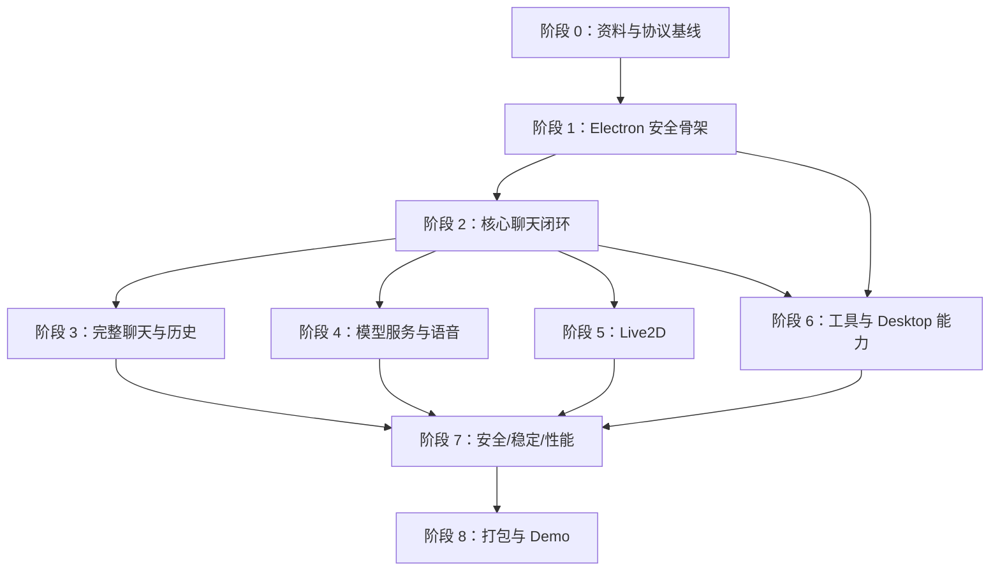

# Cyrene 前端实施路线与任务拆分

**文档版本：** v0.2  
**文档状态：** Review 修订 / 待结合现有仓库排期  
**适用范围：** Electron Desktop Demo 前端实施  
**文档日期：** 2026-08-03  
**最后复核日期：** 2026-08-04

> 本文是技术任务拆分，阶段编号与 `12-Cyrene-前端开发启动清单与分阶段实施计划-v0.1.md` 保持一致。文档 12 决定进入条件和验收门槛，本文补充模块、依赖和工程任务；两份文档不再使用不同阶段含义。

---

## 1. 实施目标

按照可独立验证的增量完成前端，避免全部模块一起开发后才第一次接入真实后端。

最终 Demo 需要证明：

1. Electron 客户端可在 Windows 和目标 Ubuntu 环境启动；
2. 可以接入现有后端完成会话、流式回复和中断恢复；
3. 一次 AI 回复的多个句子稳定归组，并区分 Inner Voice 与 Public Reply；
4. 完整聊天、历史、多媒体、表情和语音链路可用；
5. Live2D 在聊天右侧展开、可切换、可降级且不阻塞聊天；
6. Backend 与 Desktop 工具可区分，Desktop 工具经过 Main、权限和审计；
7. 文件选择、读取、写入和截图形成真实后端闭环；
8. 关键安全、稳定性、性能和跨平台要求通过验收；
9. 可生成、安装和追溯平台产物。

## 2. 开发前需要取得的后端资料

这些资料只用于实现 `BackendAdapter`，不要求重构现有后端：

- 测试环境、认证和凭据刷新方式；
- REST、WebSocket、SSE 或混合连接样例；
- 会话列表、历史游标、发送、确认和停止生成接口；
- 一次完整流式回复的原始事件记录；
- `messageId/responseId/segmentId/segmentIndex` 和父回复完成语义；
- Inner Voice/Public Reply、Token、实际模型和心情字段；
- 附件上传、下载、鉴权和过期刷新方式；
- 历史查看器的关键词、日期、分类查询和来源跳转字段；
- LLM、STT、TTS Profile 查询、测试、切换和自定义 CRUD；
- 普通录音输入、实时语音会话、字幕、断句和语音轮次事件；
- 输入法转写专用 STT 选择、取消和最终文字事件；
- Backend/Desktop/Local Worker 工具标识、状态、结果、取消和幂等结构；
- 错误、心跳、重连和续传规则。

缺少真实接口时可以使用 Mock 推进，但对应任务只能标记为“已开发、未联调”。

## 3. 阶段 0：资料、协议与工程基线

### 3.1 技术任务

- 建立或接管前端仓库和目标分支；
- 固定 Node、包管理器、Electron、Vue、TypeScript 和锁文件策略；
- 填写通信文档中的后端对齐表；
- 建立前端领域类型、运行时 Schema 和公开错误模型；
- 把真实事件整理为可重复播放的脱敏夹具；
- 建立 Main 中的 `BackendAdapter` 接口和 Mock Backend；
- 建立类型检查、格式检查、单元测试和最小 CI；
- 确认主验收平台、Live2D 资源与许可。

### 3.2 技术产出

- 可运行空工程；
- `shared/contracts` 与 Schema 初版；
- Adapter 骨架及真实事件映射说明；
- Mock Backend/事件回放夹具；
- README、开发和测试命令。

### 3.3 完成标准

- [ ] 新环境按 README 可以启动；
- [ ] 类型检查、格式检查和最小测试通过；
- [ ] 至少一条真实事件可以映射并回放；
- [ ] 未确认协议集中登记，没有散落在组件中的猜测；
- [ ] 仓库中不存在明文凭据或真实敏感样例。

## 4. 阶段 1：Electron 安全骨架

### 4.1 技术任务

- 建立 Main、Preload、Renderer 分层；
- 配置 Context Isolation、Renderer Sandbox、导航和新窗口限制；
- 让 Main 拥有后端 Transport、认证凭据和原始协议解析；
- 建立具名、可校验的 IPC API 和公开事件订阅；
- 实现窗口、单实例、外部链接和应用生命周期；
- 建立普通设置、系统安全凭据、日志、诊断和临时目录；
- 建立开发、测试、生产配置和最小打包流程。

> **阶段 1 块 A 状态（2026-08-09）：** 「建立开发、测试、生产配置和最小打包流程」及对应的安全加载/环境基线已落地——打包/构建产物 Renderer 经 `cyrene://` 受限协议加载（替代 `file://`）、严格 CSP（响应头 AND 保留 meta、`frame-src 'none'`）、dev/test/prod 三环境（`__APP_MODE__` 烘焙 + `resolveAppConfig`）、生产安全默认（DevTools 恒关 + 远程调试门）、electron-builder `dir` 未分发包 + `verify:artifact`。详见 doc 07 §4/§5、doc 09 §3/§5 与 doc 16 §4。
>
> **阶段 1 块 B 状态（2026-08-10）：** 主进程受信服务落地——凭据存储（`safeStorage` 加密 `config/credentials.json` 0600/版本化/原子写 + `credentialStatus` 4 值 IPC，Renderer 只经 IPC 见状态）+ 日志/审计（手写 JSONL logger 无 msg 参数 + 落盘双净化、append-only 审计按日 + 30 天清理、共享 file-writer rotate 5MB×3）+ 装配（before-quit allowQuit 防挂死 flush）。详见 doc 07 §11/§12 与 doc 16 §4。

### 4.2 完成标准

- [ ] Renderer 无 Node、任意 IPC、系统凭据或带凭据后端直连；
- [ ] 非白名单通道、非法参数和超大输入被 Main 拒绝；
- [ ] Token/密钥只显示状态，不能从 Renderer 读回；
- [ ] 生产配置默认关闭开发者模式和 DevTools，远程调试端口始终关闭；
- [ ] Windows 与目标 Ubuntu 开发环境至少各启动一次。

## 5. 阶段 2：核心聊天纵向闭环

### 5.1 技术任务

- 连接、认证、心跳、重连和公开错误状态；
- 会话列表、当前会话、历史第一页和基本管理；
- 用户发送、乐观状态、确认和 `clientRequestId` 幂等；
- `generation.started/delta/segment.completed/completed/failed`；
- 按 `responseId` 归并有序 `AssistantSegment[]`；
- Inner Voice/Public Reply 全局分段顺序和独立展示；
- 回复/会话 Token、实际模型和心情；
- Markdown、代码块、复制、停止生成和基础恢复；
- Adapter、流式累加器和 Store 契约测试。

### 5.2 完成标准

- [ ] 使用真实后端完成新建会话、发送和流式回复；
- [ ] 同一回复只显示一组头像、时间和操作区；
- [ ] 分段完成不会提前结束父回复；
- [ ] 重复、乱序和迟到增量不会产生重复或污染；
- [ ] 停止和断线保留已生成内容；
- [ ] UI 不引用后端原始字段。

## 6. 阶段 3：完整聊天、历史和多媒体

### 6.1 技术任务

- 四区主布局、会话栏折叠和 Live2D 右栏预留；
- 历史游标懒加载、虚拟列表和滚动锚点；
- 每会话草稿、离线缓存和损坏恢复；
- 点击、拖拽、粘贴共用的附件校验与待发送队列；
- 图片、视频、音频、文件、链接和错误/过期状态；
- 统一聊天历史查看器：关键词、日期、分类、分页和来源跳转；
- 将原消息搜索与会话媒体统一到历史查看器（分类：全部、图片/视频、表情、文件、音频、链接）；
- Emoji、表情包清单、最近使用、发送引用和历史分类；
- 键盘、焦点、中文输入法和基础可访问性。

### 6.2 完成标准

- [ ] 1100 × 700 可用，窄窗口不会出现 Live2D 覆盖聊天；
- [ ] 历史懒加载不改变当前可视锚点；
- [ ] 切换会话不丢草稿；
- [ ] 拖拽附件只进入待发送队列，不自动上传或发送；
- [ ] 图片、视频和音频可预览/播放，失败状态可解释；
- [ ] 历史查看器可组合查询并跳回来源消息/分段；
- [ ] Emoji 和表情包不会自动发送。

> **阶段 3 状态（2026-08-14）：** 阶段 3 四组（G1 布局响应式 / G2 历史聊天体验 / G3 附件多媒体 / G4 历史查看器+表情+无障碍）全部落地并全量验证（894 单测（80 files）+ 39 集成（10 files）+ typecheck/lint/build + check:contract(13/13) 全绿）；新功能为 Mock 驱动标「已开发、未联调」，真实后端联调复验后升「已真实联调」。任务勾选与验收口径以活清单 doc 16 §6 为准。

## 7. 阶段 4：模型服务与语音

> **实施注记（2026-08-16，阶段 4 分两块落地）：** **批 A（模型服务 Profile 管理 + TTS 试听 + 设置中心框架）已落地并全量验证（2026-08-15）**：LLM/STT/TTS 三类 Profile 查询/新增/编辑/复制/删除保护/类型化测试/激活切换 + TTS 声音列表/试听（一次性 `tts-preview` media 路由）+ 设置中心框架；**批 B（语音：普通录音 + 实时语音会话 + 输入法转写 + TTS 自动朗读 + 设置持久化）已落地并全量验证（2026-08-16，Mock 驱动，标「已开发、未联调」）**：领域契约/raw 帧/schema 镜像（13 新事件）→ real-backend 三模式命令 + BINARY 上行 + TTS base64 帧 + `voice.error` 路由 → mock 语音/TTS 模拟 → Main 设置持久化（`settings.json`）+ `tts-live` 媒体路由 → 麦克风权限处理器 + `voice:audio-chunk` 单向守卫 → Renderer `PcmCapture` → `voiceStore`/`settingsStore`/`messageStore` 扩展 → UI（三入口 + 待发送条 + 实时条 + 转写浮层 + 语音设置子页 + consent + 会话守卫）。spec/plan 见 `docs/superpowers/specs|plans/2026-08-15-phase4a-model-services-settings-*`、`docs/superpowers/specs|plans/2026-08-16-phase4b-voice-settings-*`；决策见 `docs/review/2026-08-15-阶段4批次A-决策记录.md`、`docs/review/2026-08-16-阶段4批次B-决策记录.md`。阶段 4 新功能（A/B 两批）均保持「已开发、未联调」，真实 Windows Electron（REAL）联调为验收方；阶段 3/阶段 2 主链保持「已真实联调」。

### 7.1 技术任务

- LLM、STT、TTS 三类内置/自定义 Profile；
- Profile 新增、编辑、复制、删除保护、类型化测试和切换；
- 后端/Main/Local Worker 凭据所有权和一次性提交；
- 普通录音输入、待发送音频、试听和删除；
- 实时语音会话、字幕、VAD、断句、语音轮次和停止；
- TTS 试听、播放、取消和完成状态；
- 输入法转写专用 STT Profile、按住/松开/取消和草稿插入；
- Backend、本机、Local Worker 模型执行位置与数据去向提示。

### 7.2 完成标准

- [ ] 三类 LLM/STT/TTS Profile 可读取、测试和切换；
- [ ] 三类自定义 Profile 可安全创建、编辑和删除，密钥不回显；
- [ ] 普通录音停止后只生成待发送语音输入；
- [ ] 实时语音字幕不写入文字草稿；
- [ ] 输入法转写只把最终文字插入草稿，不创建语音消息或自动发送；
- [ ] 未经确认不会把本机音频回退上传到后端；
- [ ] 切换 Profile 只影响新请求。

## 8. 阶段 5：Live2D

### 8.1 技术任务

- `Live2DController`、SDK Adapter 和资源 Manifest；
- 至少两个合法模型配置的加载、卸载和原子切换；
- 聊天右侧布局列、缩放、偏移和响应式折叠；
- idle、listening、thinking、speaking、waiting_permission 等状态；
- 待机、眨眼、呼吸、鼠标跟随、动作和表情优先级；
- TTS 实际音频的音量口型；
- 暂停、降帧、GPU 上下文恢复和静态头像降级；
- 设置持久化和许可/资源完整性检查。

### 8.2 完成标准

- [ ] 两个已安装模型可以加载和切换；
- [ ] 角色栏作为右侧布局列展开，不覆盖消息或输入区；
- [ ] 切换失败保留当前模型和聊天状态；
- [ ] 非白名单动作、参数和资源路径被拒绝；
- [ ] 隐藏后停止高频渲染；
- [ ] GPU/资源异常不影响聊天和权限操作。

> **状态注记（2026-08-18，阶段 5 批次 A/B/C 已落地，已开发、未联调）：** 批次 A（Live2D 地基）已落地并全量验证（1400 单测（106 files）+ 83 集成（16 files）+ typecheck/lint/build + check:contract（WS 28/28 + REST 15/15）全绿）——SDK vendoring（Cubism Web SDK 5-r.5）+ 模型注册表/integrity + cyrene:// 供给 + 装配 CLI + Adapter/CubismGL + Controller/store + settings `live2d` 契约 + Panel 最小面 + Electron 集成。**批次 B（表现）已落地并全量验证（2026-08-18）**——状态机收敛表（thinking/speaking/emotional/error 优先级 + 结束回正确回退态）+ 待机眨眼/呼吸（B2 参数纯函数）+ 动作/表情白名单调度（B3）+ 无动作参数级回退（B4）+ `live2dStateSource` 状态编排（connection/message/voice 读值组合）+ 情绪态→表情本地映射 + 设置子页（CyLive2DPane，`Live2DSettings` 全量 10 字段 + `performanceMode` 四值归一）+ Panel 状态徽标/缩放偏移/鼠标跟随点击/回正 + `switchModel` 生效 id 竞态硬化 + Electron 集成新增 7 用例。**批次 C（收口，2026-08-18）已落地并全量验证**——TTS 口型数据源（`computeMouthLevel` 纯函数 + MediaElementSource→Analyser RMS + 口部写出通用化 + `CYRENE_MOCK_MOUTH_LEVEL` env 桥）、性能降级（`FrameBudget` 四值真实降帧）+ GPU 丢失一次重建（`reset(modelId?)` + 重放）+ `setVisibility` 接线、后端 `live2d.directive` 扁平冻结契约四件套 + 七值 state（剔除 error）+ 建议强度仲裁 + mock/real 桩、防御加固收口（M1 `%` 同口径/M2 registry 强校验/M3 空数组/M4 reason 闭合/F2 blink 速率/F3 expressions 空→B4/restore 分叉/批次 A F2-F4 关单）。门禁 **1599 单测（119 files）+ 97 集成（16 files）** + typecheck/lint/build + check:contract（WS 28/28 + REST 15/15）全绿，**三态=已开发、未联调**；真实 Windows Electron（REAL）联调由开发者事后凭 `docs/review/2026-08-18-阶段5批次C-联调清单.md` 执行。详见 `docs/review/2026-08-18-阶段5批次C-决策记录.md`（主会话落文）、`docs/review/2026-08-18-阶段5批次B-决策记录.md` 与 `docs/review/2026-08-17-阶段5批次A-决策记录.md`。

## 9. 阶段 6：统一工具、权限与 Desktop P0 能力

### 9.1 技术任务

- Tool Store、工具卡片、统一状态机和公开错误；
- Backend/Desktop/Local Worker Runtime 区分；
- Desktop 静态注册表、版本、Schema 和风险重算；
- `callId` 幂等、取消、超时和结果重传；
- 权限窗口、沙盒、路径/域名黑名单、范围授权和撤销；
- 审批历史、已授权命令模板/目录及空状态；
- `desktop.file.select` 与受控资源句柄；
- `desktop.file.read` 的类型、大小、路径和内容返回；
- `desktop.file.write` 的 Diff、写前哈希、原子替换和冲突保护；
- `desktop.screen.capture` 的系统选择、预览、上传确认和清理；
- 可选 `desktop.command.run` 只在范围明确确认后注册。

### 9.2 完成标准

- [ ] Backend 工具只展示，不会在客户端误执行；
- [ ] Desktop 工具只通过 Main 和本地注册表执行；
- [ ] 四个 Desktop P0 工具 ID 完成真实后端闭环；
- [ ] 未注册、未知 Runtime、版本不兼容和非法参数均安全失败；
- [ ] 黑名单优先于沙盒和历史授权；
- [ ] 相同 `callId` 不重复弹窗或产生副作用；
- [ ] 文件冲突不覆盖，截图不静默采集或上传；
- [ ] 命令执行未确认时不注册；启用时也不能接收任意 Shell 字符串；
- [ ] 审计和日志不含完整敏感内容。

## 10. 阶段 7：安全、稳定性与性能收敛

### 10.1 技术任务

- Markdown/XSS、危险链接、CSP、导航和媒体来源；
- IPC 攻击面、超大输入和来源窗口校验；
- 路径穿越、符号链接、重放和授权后参数变化；
- Token、模型密钥、聊天正文、Inner Voice、录音和本地数据泄漏扫描；
- 直接语音字幕与文字草稿隔离测试；
- 网络中断、Renderer 崩溃、缓存损坏和 GPU 上下文恢复；
- 长会话、长流式、历史资源列表和 Live2D 性能；
- 日志轮转、缓存上限、临时附件与录音清理；
- 集中修复 Blocker、Critical 和主要回归问题。

### 10.2 完成标准

- [ ] Blocker/Critical 为 0；
- [ ] 安全发布清单通过；
- [ ] 200 条混合消息、100 个多分段回复和 500 项历史资源操作正常；
- [ ] 长时间运行无明显持续内存增长；
- [ ] Live2D 关闭后 CPU/GPU 使用明显下降；
- [ ] 日志和诊断导出通过敏感信息扫描；
- [ ] 主链路异常可以恢复或安全失败。

## 11. 阶段 8：打包、跨平台与 Demo 验收

### 11.1 技术任务

- Windows 安装包和 Ubuntu 主安装产物；
- 安装、首次启动、升级、卸载和重装测试；
- 产物秘密、开发配置、Source Map 和未授权资源扫描；
- Windows/Ubuntu 实机链路与 Wayland 范围测试；
- 完整 Demo 演示脚本；
- 版本、提交、依赖、协议和资源清单；
- 发布说明、校验和、已知问题和回滚/重装方案。

### 11.2 完成标准

- [ ] Windows 主验收环境完整通过；
- [ ] Ubuntu 目标环境至少完成一次全链路；
- [ ] 生产包默认关闭开发者模式和 DevTools，远程调试端口始终关闭；
- [ ] 安装包不包含测试密钥、敏感事件样例或未授权模型；
- [ ] Demo 脚本连续执行两次结果一致；
- [ ] 版本、提交、协议和资源哈希可追溯；
- [ ] 已知问题和回滚/重装方式已记录。

## 12. 任务依赖

阶段 3、4、5 在阶段 2 通过后可以交错推进。阶段 6 可以提前实现工具壳和 Mock，但真实 Desktop 执行必须建立在阶段 1 的安全边界上，并在阶段 2 提供工具卡片归属的消息语义后完成联调。

## 13. 每个任务的 Definition of Done

任务只有满足以下条件才算完成：

- 代码实现并通过类型检查和格式检查；
- 外部输入具有运行时 Schema；
- 正常、失败、取消、拒绝和超时路径按适用范围处理；
- 关键纯逻辑有单元测试；
- 涉及 Main/Preload/Renderer 或 Adapter 时有集成测试；
- 用户可见功能有 E2E 或人工验收记录；
- 无明文秘密、未脱敏日志或未授权资源；
- 相关文档和协议对齐表同步更新；
- 已知限制已记录；
- 真实后端未通过时只标记为“已开发、未联调”。

## 14. 推荐优先决策

开始编码前优先确认：

1. 现有后端的流式传输、父回复完成和恢复方式；
2. 会话、附件、历史查询和来源跳转接口；
3. Inner Voice/Public Reply、Token、模型和心情字段；
4. LLM/STT/TTS Profile 管理、测试、凭据所有权和自定义 CRUD；
5. 普通录音输入、实时语音断句/轮次和输入法转写专用 STT 选择；
6. 工具调用、结果、取消、`callId` 幂等和 Runtime 映射；
7. 首个主验收平台、Ubuntu 桌面和 Wayland 要求；
8. 两个可合法使用的 Live2D 模型及 SDK 许可；
9. TTS 是流式还是整段音频；
10. 文件 Diff 与沙盒/黑名单/范围授权默认策略；
11. `desktop.command.run` 和 Local Worker 是否进入 Demo；
12. 安装包、签名和发布渠道。

未确认项可以通过 Adapter、接口、Mock 和功能开关隔离，不得通过在组件中写死猜测来推进。
